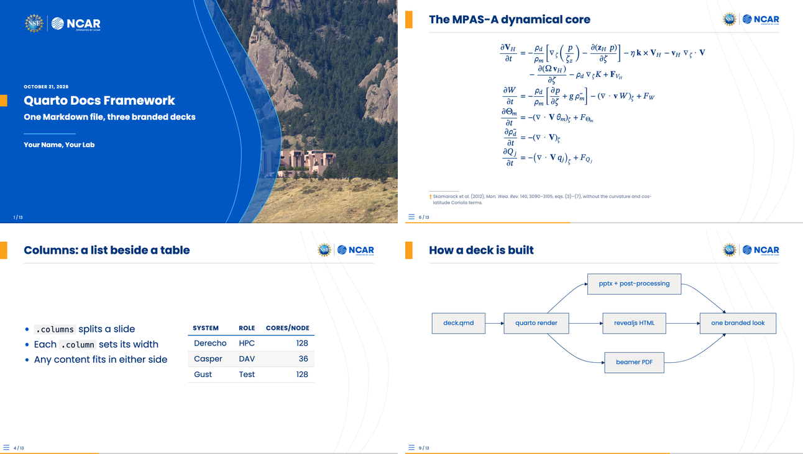
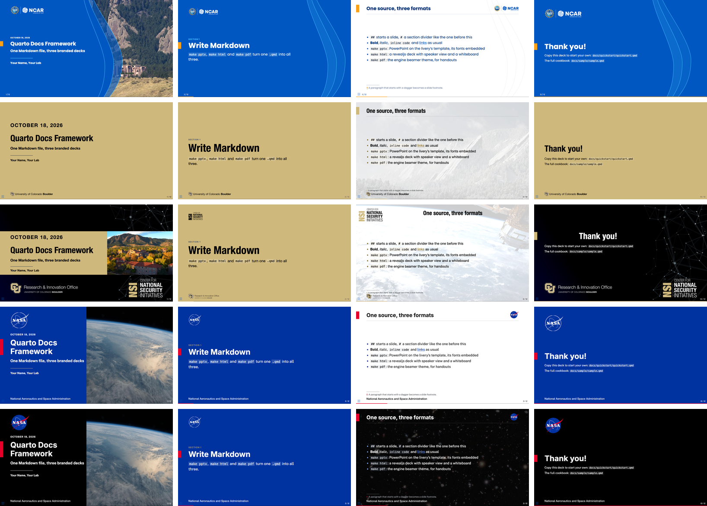
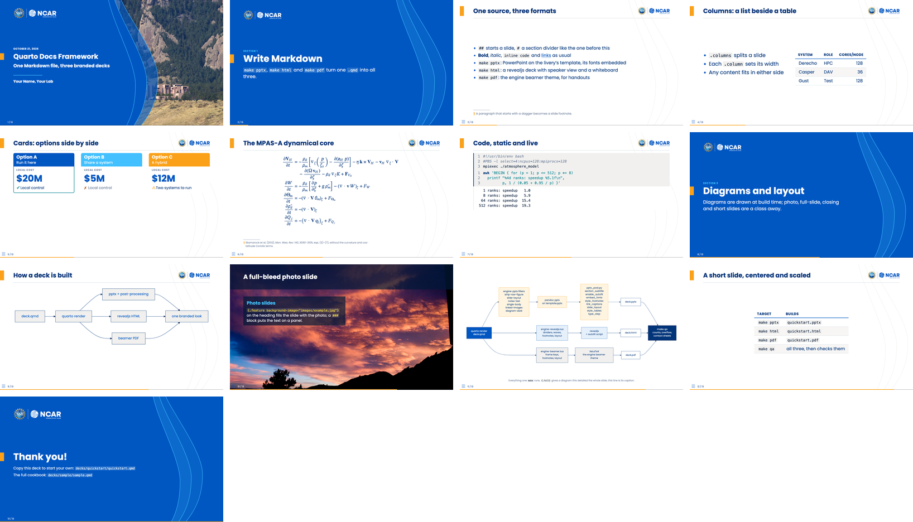
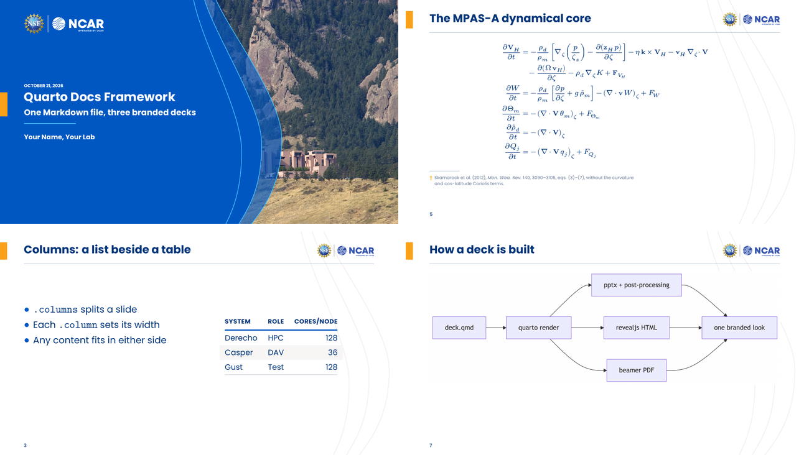

# quarto-livery-decks

A [Quarto](https://quarto.org) framework for documentation decks in any brand: one Markdown
file becomes a branded PowerPoint (`.pptx`, the first-class output), a revealjs HTML deck and
a beamer PDF. The brand is a **livery**, a directory of data and assets, and
`make pptx LIVERY=cu` is the whole switch. Three brand families ship here: NCAR, the
University of Colorado and NASA ("The liveries" below). Clone, set up the conda env, copy the
quickstart deck, write Markdown. What each release changed is in [`CHANGELOG.md`](CHANGELOG.md).



The same quickstart deck under each livery (title, divider, content, closing):



Two example decks ship with the framework:

- **`decks/quickstart/`** is twelve slides, one of each headline feature. It is the deck to
  copy when you start your own (see "What you get" below).
- **`decks/sample/`** is a **cookbook** showing one example of every capability you're
  likely to need: text formatting, math, tables, two-column layouts, image embeds,
  syntax-highlighted code, auto-captured shell output, mermaid and Graphviz diagrams,
  speaker notes, and the `` shortcode. `decks/sample/old.qmd` is a longer
  real-world example (database schema, REST API and deployment diagrams).

## Quick start

```bash
git clone https://github.com/benkirk/quarto-livery-decks.git
cd quarto-livery-decks

# 1. Build the conda env (also installs + registers the bash Jupyter
#    kernel so executable {bash} chunks work).
make conda-env
conda activate ./conda-env

# 2. Render the quickstart deck.
cd decks/quickstart
make pptx              # → quickstart.pptx (the default livery, ncar)
make html              # → quickstart.html (revealjs)
make pdf               # → quickstart.pdf  (beamer; needs TeX)
make pptx LIVERY=cu    # the same deck in another livery (any directory under liveries/)
```

Open `quickstart.pptx` (or `quickstart.html` in a browser), then copy
`quickstart.qmd` into a new deck directory and edit it (see "Adding a new deck"
below). When you need a pattern the quickstart deck lacks, `decks/sample/sample.qmd`
probably has it.

**Behind a restrictive proxy** (some cloud containers): if `quarto install
tinytex` cannot download, a system TeX Live works instead (`apt-get install
texlive-xetex texlive-latex-extra texlive-fonts-extra`). If `quarto install
chrome-headless-shell` cannot download, point Quarto at any Chromium with
`export QUARTO_CHROMIUM=/path/to/chrome`, and `make qa` at it with `CHROME`.

**No conda at hand?** The published image carries the whole environment:
`docker run --rm --user "$(id -u):$(id -g)" -v "$PWD:/work" -w /work/decks/quickstart
ghcr.io/benkirk/quarto-livery-decks make pptx` builds the quickstart deck, and any
directory of `.qmd` files mounted on `/work` builds the same way ("Building in the
container" below).

## What you get

Every slide of `decks/quickstart/quickstart.qmd`, in the HTML deck under the default `ncar`
livery:



| Slide | The Markdown behind it |
|---|---|
| [Title](decks/quickstart/screenshots/01-title.png) | the front matter: `title`, `subtitle`, `author`, `date`; the photo is the livery's default, `titlegraphic:` sets your own |
| [Section divider](decks/quickstart/screenshots/02-divider.png) | `# Write Markdown`, then a paragraph: the subtitle |
| [Bullets and a footnote](decks/quickstart/screenshots/03-text.png) | a list, then a paragraph starting with `†`; `{.vcenter scale="1.2"}` on the heading |
| [Columns](decks/quickstart/screenshots/04-columns.png) | `:::: {.columns}` with a list in one `.column` and a table in the other |
| [Equations](decks/quickstart/screenshots/05-math.png) | LaTeX between `$$`: OMML in pptx, MathJax in HTML, real TeX in the PDF |
| [Code, static and live](decks/quickstart/screenshots/06-code.png) | a ` ```bash ` block, and a ` ```{bash} ` cell run at render time |
| [Diagram](decks/quickstart/screenshots/07-mermaid.png) | a ` ```{mermaid} ` cell (Graphviz ` ```{dot} ` works the same way) |
| [Photo slide](decks/quickstart/screenshots/08-feature.png) | `{.feature background-image="..."}`, the text in a `###` block |
| [Full-slide diagram](decks/quickstart/screenshots/09-full.png) | `{.full}` on the heading: one diagram or image, then an optional caption paragraph |
| [Short slide](decks/quickstart/screenshots/10-short.png) | `{.center scale="1.4"}` on the heading |
| [Closing](decks/quickstart/screenshots/11-closing.png) | `## Thank you! {.closing}` |

The same source as a beamer PDF (`make pdf`):



The pptx is the same deck again, on the livery's PowerPoint template. To refresh these
images after editing the deck, run `make screenshots` in `decks/quickstart/` (the shots
above) and `make gallery` (the livery rows); both need everything `make qa` does (see
"Checking a deck").

## The liveries

A livery is a brand as data: a palette and fonts (`_brand.yml`, Quarto's brand.yml
standard), the engine's knobs (`livery.yml`: roles, geometry, marks, art, type sizes), and
its fonts, logos and pictures. From that one directory the engine draws the HTML and PDF
themes and generates the PowerPoint template, so the three formats wear the same brand. A
livery can be a *flavor* of another (`extends:`), naming only what differs.

| Family | Liveries | Faces | Marks | Look |
|---|---|---|---|---|
| **NCAR** | `ncar` (NSF NCAR, the default); `ucar`, `ucp` and `ncarucar`, the brand guide's other lockups | Poppins, bundled, embedded in the pptx | each member's lockup top right | the 2026 brand palette; deep-blue fields and the wave super-graphic; the Mesa Lab on the cover |
| **University of Colorado** | `cu` (CU Boulder); `nsi`, the Center for National Security Initiatives (`extends: cu`) | Helvetica Neue where installed; TeX Gyre Heros, Condensed for headings, standing in | `cu`: the CU Boulder lockup as a sign-off, bottom left; `nsi`: the center's mark top left, the Research & Innovation Office lockup as its sign-off | gold fields, a faded Flatirons photo behind content; `nsi`: its master deck's band title, a satellite photo behind content, centred titles |
| **NASA** | `nasa` (external communication, on white); `nasa-dark` (`extends: nasa`, on black); program liveries belong here too | NASA's digital faces, bundled: Inter headings, Public Sans body, DM Mono code | the insignia top right and the agency name at the foot, the brand's preferred identifier | NASA Blue fields with the white-rule insignia; `nasa-dark`: content on black over a faint deep field, cover and closing on black |

`make <format> LIVERY=<name>` picks one of `liveries/` (`ncar` is the default);
`LIVERY_DIR=<path>` takes a livery from anywhere (a repo's own, say). Each livery's
`reference/notes.md` records its sources and every judgement call, and CI builds the
quickstart deck under each one.

**Dark liveries.** A livery whose background role is darker than its foreground (`nasa-dark`)
sets its content slides light on dark, and everything follows: code gets its own `code-text`
role (the `dark` role stays a field color), tints mix toward the background, callouts and
tables take dark shades, and the mermaid and Graphviz diagrams, which Quarto renders as dark
on white, are turned to the dark with their hues kept (`diagram-dark.lua`).

## Layout

```
quarto-livery-decks/
├── bin/livery             # the livery command (liveries/README.md), on PATH after config_env.sh
├── Make.common            # shared per-deck recipes (pptx/html/pdf/qa/measure/site/publish/overleaf/charts-zip/clean)
├── _extensions/engine/    # the engine (symlinked into decks): the pptx, beamer and revealjs
│                          #   formats and their Lua filters, pptx_post.py and its steps
│                          #   ("Build pipeline" below), livery.py (the `livery` command and reader), the livery tools, the chart colors (livery_charts.py), the
│                          #   Overleaf and charts packers, mpl/livery_mpl.py (plots)
├── liveries/              # one directory per livery (`make LIVERY=<name>`; README.md, REFERENCE.md):
│   ├── ncar/  ucar/       #   _brand.yml, livery.yml, fonts/, logos/, art/,
│   ├── ucp/  ncarucar/    #     template.pptx and build/ (both generated, committed),
│   ├── cu/  nsi/          #     reference/notes.md
│   └── nasa/  nasa-dark/
├── common/                # what decks share:
│   ├── _quarto.yml        #   the Quarto config (symlinked into decks)
│   └── utils/
│       ├── deck_qa.py          # `make qa`: overflow, slide counts, contact sheets
│       ├── comp_measure.py     # `make measure`: the drawn slides against their compositions
│       ├── site_index.py       # `make site`: the index page
│       └── fit-waves.py        # fits a brand's wave curves to its cover art (art.waves)
├── decks/
│   ├── quickstart/        # the short exemplar deck: copy this one
│   │   ├── quickstart.qmd
│   │   ├── screenshots.py  (make screenshots: the README images)
│   │   ├── gallery.py      (make gallery: the livery rows above)
│   │   └── screenshots/    (those images, committed)
│   ├── fixtures/          # small decks for the title variants and type steps,
│   │                      #   for parity.sh and CI
│   ├── plots/             # the plots cookbook (jupyter: python3, matplotlib, seaborn);
│   │                      #   its README.md, gallery.py (make gallery) and screenshots/
│   └── sample/            # the cookbook deck
│       ├── Makefile        (one line: include ../../Make.common)
│       ├── _quarto.yml     (symlink → ../../common/_quarto.yml)
│       ├── _extensions     (symlink → ../../_extensions, made by make)
│       ├── _livery         (symlink → the livery in use, made by make)
│       ├── sample.qmd      (the cookbook)
│       ├── old.qmd         (a longer real-world example)
│       └── images/         (drop your PNGs / JPGs here)
├── latex/                 # the engine's pure-LaTeX side: talk.tex (the starter),
│                          #   examples/ and their variants (`make latex`)
├── design/                # the design (engine-and-liveries.md) and the sprint handoffs
├── tests/                 # the engine's tests (`make test`) and the parity harnesses:
│                          #   parity.sh (every deck, every livery), parity-latex.sh (latex/)
├── Makefile               # top-level: `make conda-env`, env mgmt, `make latex`, `make test`
├── conda-env.yaml         # quarto + jupyter + bash_kernel + the scientific stack + helpers
├── Dockerfile             # the build-environment image ("Building in the container")
├── etc/                   # config_env.sh, the image's entrypoint
└── conda-env/             # local conda prefix, gitignored
```

## Build pipeline

Per deck, `make pptx` runs:

1. `quarto render <deck>.qmd --to engine-pptx -o <deck>.pptx`, the engine's pptx format,
   with `reference-doc: _livery/template.pptx` from the deck's `_quarto.yml`, so the output
   inherits the livery's theme colors, layouts and masters. Code is highlighted in the
   livery's colors (`_livery/build/livery.theme`, as in HTML and PDF), set in its code face
   when it has one, and the format's Lua filters (in `_extensions/engine/`) prepare the
   document for pandoc's pptx writer:
   - `strip-raw-figure.lua`, `notes-last.lua` and `single-body.lua` keep pandoc from
     demoting or splitting slides (raw `<figure>` wrappers, notes before columns, text
     after a table or image);
   - `slide-layout.lua` carries a slide's layout classes over as a notes line for `slide_layout`;
   - `linked-images.lua` writes a linked picture's URL (HTML and PDF too; see "Linked images");
   - `diagram-dark.lua` turns the diagram pictures to the dark under a dark livery (PDF too).
2. `python3 _extensions/engine/pptx_post.py <deck>.pptx`, the engine's post-render steps
   (`_extensions/engine/pptx_steps/`). It opens the deck once, runs them in this order and
   saves once:
   - `section_subtitle`: merges the paragraph after a `#` section heading back onto the
     Section Header slide as its subtitle (pandoc drops it onto a separate untitled slide),
     then dresses every divider as the HTML and PDF decks draw it: the livery's "SECTION n"
     label, its tab, the block centered and measured in the livery's fonts. The field, logo
     and art come from the template's Section Header layout (see "Template constraints").
   - `enable_autofit`: flips every body placeholder from "Do not Autofit" to "Shrink text
     on overflow" (see "About text autofit").
   - `embed_fonts`: re-injects the livery's font variants as `<p:embeddedFont>` entries,
     which pandoc strips, so the font travels with the file (see "About the fonts").
   - `style_footnotes`: restyles body paragraphs that start with `†` or `‡` as footnotes
     (smaller, the livery's muted color, the marker in its accent), since pandoc ignores
     inline size and color. HTML and PDF go further: the theme moves them to the slide's foot.
   - `link_captions`: captions each linked picture (see "Linked images") with its URL,
     bottom center, muted; the caption box is itself the link.
   - `slide_layout`: applies a slide's layout controls (see "Centering and scaling a
     short slide"); builds the photo covers and feature slides; points closing and light
     title slides at the template's extra layouts; copies the slide number onto every slide.
   - `style_tables`: styles every table as the HTML theme does (a bold capitalized header
     over a rule in the primary color, thin rules between rows, every second row banded, the
     blends from `livery_build.py`); pandoc always writes "Medium Style 2", so the look is set
     cell by cell, and evenly split columns are re-split by content.
   - `type_step`: applies a deck's `type-body:` or `type-scale:` (see "Text sizes and the
     slide size").

`make html` (revealjs) and `make pdf` (beamer) run step 1 with the engine's own format and
filters, which draw everything step 2 adds to the pptx.

## Text sizes and the slide size

Each livery states its text sizes in whole or half points on its PowerPoint canvas, from the
brand's own template or deck. ncar uses the NSF NCAR template's 10 x 5.625 in slide, with a 12 pt
body, 12/11/10/9/8 pt list levels, 20 pt slide titles and a 22 pt cover title. cu and nsi use
the NSI deck's 13.33 x 7.5 in slide, with a 16 pt body, 32 pt titles and 60 pt dividers. nasa
and nasa-dark use the NASA Science public-engagement deck's 10 x 5.625 in slide, with a 12 pt
body and 22 pt titles. So a slide copied from a built pptx into a hand-made deck on that
template keeps its geometry and its round sizes. HTML and PDF set the same sizes as the same
share of the slide, so a slide fits, or overflows, alike in all three. `scale="S"` on a slide
sizes it in every format, and PowerPoint's sizes round to the half point.

A whole deck can step its sizes down (or up) from the livery's, in all three formats:

```yaml
type-body: 10      # the body in points; every size scales by 10/12 under ncar
# type-scale: 0.85 # or a plain factor (type-body wins if both are set)
```

The NSF NCAR guide's "10 pts for three and four column layouts" is `type-body: 10`. PowerPoint
gets every size rounded to the half point (`type_step.py`), and a slide's `scale=` multiplies
on top. In plain LaTeX or Overleaf, the theme option `typescale=0.85` does the same. A livery's
sizes live in its `livery.yml` (`type:`, `pptx.size`; `livery_build.py`'s `TYPE` lists the roles).

## About text autofit

Pandoc's PPTX writer emits empty `<a:bodyPr/>` on every placeholder,
which corresponds to PowerPoint's "Do not Autofit": long text overflows
the placeholder visually. `enable_autofit.py` rewrites these to
`<a:bodyPr><a:normAutofit/></a:bodyPr>`, which sets the dropdown to
"Shrink text on overflow."

PowerPoint computes the actual `fontScale` only on edit, not on load, so the file opens with
overflowing text; a click into any overflowing cell triggers the recompute and the text
shrinks permanently. Author-side discipline (split walls of text, use columns) beats driving
PowerPoint externally, so nothing is wired up for that.

The HTML deck fits itself: a content slide that runs past the bottom margin
shrinks its body text (down to 65%) until it fits, keeping the title size.
`{.smaller}` sets a slide smaller from the start:

```markdown
## Wall of text {.smaller}
```

PPTX silently ignores `{.smaller}`; revealjs honors it. Opt a slide out of
the HTML autofit with `{.no-autofit}` (or `{.scrollable}`), or a whole deck
with `themeoptions: [autofit=false]`. Beamer never shrinks overflowing text: add
`{.shrink}` to a dense slide's heading to scale that one slide down (pptx ignores the
class), or check it with `make qa`.

## About the fonts

Every livery bundles the fonts its HTML and PDF decks use (the brand's own when they are
free, a free stand-in otherwise), so there is nothing to install. The pptx template's font
scheme names the livery's typeface (`pptx.typeface`, and `pptx.heading-typeface` for a second
headings face), so slide masters and layouts all dereference to it:

- **ncar** names Poppins and embeds it (`pptx.fonts`, four `.fntdata` blobs), so the file
  carries its font to any machine.
- **cu** and **nsi** name Helvetica Neue, a commercial face, and embed nothing: Macs have it,
  Windows substitutes Arial. HTML and PDF use it where it is installed (below).
- **nasa** and **nasa-dark** name Public Sans and Inter. They embed once the livery carries
  PowerPoint's `.fntdata` blobs (made by one PowerPoint save with "Embed fonts" on); until
  then a viewer without the faces sees PowerPoint's substitute.

A livery's code face (`typography.monospace` in `_brand.yml`, with files of its own: nasa's
DM Mono) sets code in all three formats: pandoc's `monofont` in pptx, the code font in HTML
and the PDF. The other liveries use each format's default code fonts.

Embedding is only needed when the `.pptx` will be opened on a machine without the font;
without it, PowerPoint substitutes (typically Calibri). If every viewer has the font, drop
the `embed_fonts.py` step from `Make.common`.

### Installed brand fonts

Some brand faces are commercial and cannot ship in the repo or a published site: cu's
Helvetica Neue is Monotype's, so cu bundles TeX Gyre Heros (and Heros Condensed for
headings) and names the real face in `livery.yml`:

```yaml
installed-fonts:
  base: Helvetica Neue                  # a family: its four faces by the usual names
  headings:                             # or faces by full and PostScript name
    family: Helvetica Neue
    faces: {bold: [Helvetica Neue Condensed Bold, HelveticaNeue-CondensedBold],
            regular: [Helvetica Neue Condensed Bold, HelveticaNeue-CondensedBold]}
```

- **HTML**: each `@font-face` lists the installed face as `local()` sources ahead of the
  bundled file, so a viewer who has it (every Mac and iPhone) sees Helvetica Neue and anyone
  else Heros. Nothing is copied.
- **PDF**: a deck opts in with `themeoptions: [fonts=brand]`; the theme then loads the
  installed faces when the machine building the PDF has them and embeds them for every
  reader (built on Linux, it falls back to Heros). The shared `fonts=bundled`, CI, parity
  and the Overleaf zips ignore installed fonts, so their output never depends on the machine.
- **pptx**: nothing to do; the theme names `pptx.typeface` (Helvetica Neue) already.

The framework never copies the font. Embedding an installed font in a PDF you hand out is a
question for that font's licence: macOS's covers using its fonts, not redistributing the
files, which this never does; check before you publish a PDF built this way.

## Template constraints

Each livery's `template.pptx` is generated by `livery template`
(`_extensions/engine/livery_template.py`) from the livery's data (`build/livery.json`:
theme slots, typeface, marks, geometry, art); never edit it by hand, change the
livery and rerun `make livery`. It keeps the things pandoc is strict about:

- **`slideLayout1` placeholders**: must include all five of `ctrTitle`,
  `subTitle`, `dt`, `ftr`, `sldNum`. Pandoc emits empty `<p:sp/>` stubs
  for any missing placeholder, which PowerPoint then flags as corrupt
  ("Repair?" prompt on open).
- **Layout names**: pandoc looks up layouts by display name. The title
  slide layout must be named exactly `Title Slide`; other layouts pandoc
  knows about are `Title and Content`, `Section Header`, `Two Content`,
  `Comparison`, `Content with Caption`, `Blank`. Missing names don't
  break the build but trigger a `Couldn't find layout named …` warning
  and fall back to pandoc's bundled layout (losing the brand's styling for that
  slide).
- **Placeholder indices**: pandoc matches content boxes by `idx` as well as
  type, so the date, footer and slide-number placeholders carry indices (20-22)
  no content box uses; a collision drops a column into the footer's box.
- **Two more layouts pandoc never picks**: `Closing` and `Title Slide (light)`.
  Pandoc copies every layout of the reference doc into the deck but chooses only
  by the names above (its choice between two layouts of one name is undocumented,
  so every name is unique). `slide_layout.py` points a `{.closing}` slide at
  `Closing`, and the title slide at `Title Slide (light)` when the deck's front
  matter sets `themeoptions: [..., title=light]`; in PowerPoint both are in the
  layout menu for slides added by hand.

Verify after any template change:

```bash
unzip -p liveries/ncar/template.pptx \
  ppt/slideLayouts/slideLayout1.xml | grep -oE '<p:ph[^/]*/>'
# expect 5 matches
```

## PDF (beamer)

`make pdf` renders with `--to engine-beamer`. That format comes from the engine's
beamer theme in `_extensions/engine/` (until 2026-10 its own repository,
[benkirk/beamer-livery-theme](https://github.com/benkirk/beamer-livery-theme)). Make symlinks
`_extensions` into each deck directory, just as it does for `_quarto.yml`.

- **You need Quarto 1.6 or newer** (the conda env pins it): the theme's Lua
  filter uses a pandoc macro that older Quarto releases lack.
- **You need TeX with XeLaTeX.** Quarto's own TinyTeX (`quarto install
  tinytex`) works and installs missing LaTeX packages on the fly. So does a
  system TeX Live. (Plain-LaTeX decks, not Quarto ones, can also be written
  on Overleaf: [`latex/README.md`](latex/README.md).)
- **No fonts to install** (see "About the fonts").
- **Theme options** go in a deck's front matter:
  `themeoptions: [title=light, fonts=bundled]`. A deck-level
  list replaces the shared one, so keep `fonts=bundled` (from the shared
  `_quarto.yml`): it pins the livery's bundled fonts and never probes for a
  system copy (`fonts=brand` uses an installed brand face instead; see
  "Installed brand fonts").
  - `titlegraphic: images/photo.jpg` puts a photo on the title slide, in every
    format, where the livery's title composition places it. Without one the livery's
    default appears (`art.titlegraphic`: ncar's Mesa Lab, nsi's campus, nasa's Earth
    limb); `titlegraphic: none` keeps the plain cover.
  - `fineprint: "..."` adds small print under the title block.
  - `mathfont=stix` (or `lm`, `pagella`, `sans`, `fira`, `poppins`, any
    OpenType math font) changes the math font; the default is New Computer
    Modern Math, scaled to sit with the text font. Quarto's own `mathfont:` key
    also works. "Math fonts" below shows every preset on one slide.
  - `waves=false` removes the faint wave lines behind content slides of a
    livery that has them (they are on the pptx master too).
- **Markdown extras:**
  - `## Title {.feature background-image="images/photo.jpg"}` makes a
    full-bleed photo slide (`background=` also works; `background-image=`
    doubles as the revealjs background). Its look is the livery's `feature.style`:
    `bar` (the title on a dark bar, the text on a translucent panel; the default) or
    `cover` (the title cover's field and waves, the photo beside them), in every format.
  - `## Title {.full}` gives one diagram or image the whole slide: no title,
    logo or rule, and the paragraph after it becomes a one-line caption. The
    title stays in the source for navigation and `make qa`. pptx gets it
    from `slide_layout.py`.
  - `## Thank you! {.closing}` makes a closing slide.
  - `### Heading {.example}` / `{.alert}` give block variants.
  - `[text]{.alert}` emphasizes text.
- **Dense slides**: beamer has no autofit; see "About text autofit".

### HTML (revealjs)

`make html` renders with `--to engine-revealjs`, the web format from the same
extension. The deck looks like the PDF: title slide with the livery's
art (or `titlegraphic:`), section dividers with subtitles, content slides
with the livery's title and marks, `.feature` and `.closing` slides. The same
`themeoptions:` apply (`title=`, `waves=`; math in the browser is
MathJax's, so `mathfont=` does not). Open `<deck>.html` in a browser
and keep `<deck>_files/` beside it.

- **Presenting:** `s` speaker view (notes), `m` slide menu, `b`/`c`
  whiteboard / draw on the slide, `f` full screen.
- **HTML-only extras:**
  - `## Title {.brand-dark}` puts a content slide on the livery's dark color with
    white text (under a dark livery, every content slide already is); pptx and PDF
    draw an ordinary slide.
  - Overflowing content slides shrink to fit (see "About text autofit").
  - Mermaid and Graphviz draw live in the browser; mermaid uses the livery's
    colors and font where pptx and PDF carry a picture of it.
- **One file to share:** in a deck's front matter,
  ```yaml
  format:
    engine-revealjs:
      embed-resources: true
      chalkboard: false     # the whiteboard can't be embedded
  ```
  gives a single self-contained `.html`.
- **PDF from the browser:** open `<deck>.html?print-pdf` in Chrome and print
  with background graphics. `make pdf` is usually the better handout.

## Checking a deck

`make qa` builds every format, then checks the outputs (`common/utils/deck_qa.py`):

- **Failures:**
  - slide counts that differ between pptx, PDF and HTML;
  - PDF text past the right margin, into the footer, overlapping other text, or running into
    the next table column;
  - HTML content past the right edge;
  - a bare `<word>` in the sources, outside code and backticks: revealjs reads it as a tag
    (reported as `file:line`).
- **Hints:**
  - short slides, with the share of the body they use;
  - `.smaller` without `.fill`;
  - slides the HTML autofit had to shrink.
- **Plain names:** list names that belong in backticks in `qa-names.txt` (one per line) in
  the deck directory, and every plain-text use is reported.

Everything lands in `_qa/` (gitignored): `report.txt`, `usage.tsv`, a contact sheet per
format, and per-slide PNGs. In a directory with several decks, `make qa DECKS=name`
checks one.

`make measure` checks the slides a livery composes, the title, divider, feature and closing
slides, against their **compositions**: the boxes in the livery's `build/livery.json` that
say where each one's field, photo, marks and text go, which every format draws from. It
shoots those slides in all three formats, measures every edge against its box and writes
`_qa/measure.tsv` and a contact sheet, `_qa/compositions-<livery>.png`; `MEASURE_FAIL` names
the formats whose misses fail the run.

The checks need poppler, Pillow and Playwright, which are all in `conda-env.yaml`
(`make measure` also LibreOffice, to shoot the pptx). `make conda-env` installs Playwright's
headless Chromium; set `CHROME` to use another build. Without Playwright the HTML checks are
skipped and the rest run. For Claude Code, the `deck-polish` skill (`.claude/skills/`)
covers what to do with the findings.

## Adding a new deck

```bash
cd decks
mkdir roadmap && cd roadmap

cat > Makefile <<'EOF'
include ../../Make.common
EOF

# then author roadmap.qmd. _quarto.yml is auto-symlinked from
# ../../common/_quarto.yml on first `make` invocation.
make pptx
```

`Make.common` infers the deck name from `$(notdir $(CURDIR))`, so the
output file is `<dirname>.pptx`. Override with `OUT=foo` if needed.

A directory can hold several decks that share images and fragments, e.g. a
full deck plus one deck per part:

```make
DECKS := roadmap 1-intro 2-details
include ../../Make.common
```

Each `<name>.qmd` builds `<name>.pptx` / `.html` / `.pdf`, and `make pptx`
builds all of them. Put shared slide bodies in `_*.qmd` fragments and pull
them in with ``; quarto skips underscore files
when rendering, and make treats every `_*.qmd` and `data/*` in the directory
as a prerequisite of every deck, so editing one rebuilds them all.

A deck that needs custom Quarto config (a different reference template,
extra extensions, etc.) can replace the symlinked `_quarto.yml` with a
real file: `make` sees the file already exists and skips the symlink
recipe.

### Linked images

Wrap an image in a link and the picture opens that page, in every format:

```markdown
[{height="72%" fig-align="center"}](https://example.org/dashboard)
```

Each format also shows the URL, small and muted, so a reader knows the
picture is live: the slide footer in HTML, a line at the foot of the PDF page
(the engine's `linked-images.lua`), and a caption box in pptx (`link_captions.py`;
pandoc can't add one without splitting the slide). One line per slide, from
its first linked image. `{height="72%"}` is the full-width screenshot recipe
and fits all three.

### Centering and scaling a short slide

Six per-slide controls on the heading, each independent, act on the body
(everything but the title, speaker notes and footnotes). The engine's themes draw them
in HTML and PDF; pptx gets them through `slide_layout.py` (step 7).

```markdown
## Who's still on legacy {.center scale="1.4"}
## A short script {.hcenter .fill}
```

| Control | HTML | PDF | pptx |
|---|---|---|---|
| `.hcenter`: center the body across as a block | yes | prose, lists, plain code (a table centers anyway) | no |
| `.vcenter`: center it between the title and the floor | yes | yes | text yes; a table to its measured center |
| `.center`: both (the theme's, not Quarto's) | yes | yes | as `.vcenter` |
| `scale="S"`: text, tables and code × S | yes (autofit shrinks an overshoot) | yes (no autofit: check the page) | yes |
| `.fill`: grow until it just fits, up to 3× | yes | no; add `scale=` | no; add `scale=` |
| `.caution`: the body on a soft field with a bar in the warning color, for warning slides | yes | yes | yes; the box cut to its measured text, footnotes inside it |

### Executable shell chunks

Quarto can capture the live output of a shell command at render time:

````markdown
```{bash}
#| echo: true
which mpicxx && mpicxx --version
```
````

Both the command and its captured stdout land on the slide. This needs
the Jupyter `bash` kernel, which `make conda-env` installs and registers
into the env (`bash_kernel` pip package + `python -m bash_kernel.install
--sys-prefix`). The deck's frontmatter must opt in:

```yaml
engine: jupyter
jupyter: bash
```

Code runs on the build host, not the viewer's machine: output is baked
into the .pptx.

## Plots and chart colors

A Python plot wears the livery with no styling code: its chart colors, its font, and the slide's
own text sizes, in all three formats (design/charts-and-plots.md). `decks/plots/plots.qmd` is
the cookbook: lines, a seaborn bar chart from pandas, a stacked area in hue families, a heatmap,
a diverging field, two plots in columns, math in the labels, a dark slide.
[`decks/plots/README.md`](decks/plots/README.md) shows it under every livery, with each livery's
chart colors.

````markdown
---
engine: jupyter
jupyter: python3
---

```{python}
#| include: false
import livery_mpl            # the livery's fonts, colormaps and helpers
import matplotlib.pyplot as plt
```

## A plot

```{python}
fig, ax = plt.subplots()     # the content area: labels at the body size
ax.plot(x, y)                # the livery's categorical colors, in order
plt.show()
```
````

- **What does it.** Each livery's `build/livery.mplstyle` (generated with its other files)
  holds the chrome of its mode, transparent figures (a plot sits on any field, dark ones too),
  the categorical colors as the color cycle, the brand font over DejaVu Sans, and sizes in
  points on the PowerPoint canvas: axis labels at the body size, ticks and legends a list level
  down. `Make.common` exports it as `MATPLOTLIBRC`, puts the engine's `livery_mpl` on
  `PYTHONPATH` and passes the content area as the deck's `fig-width`/`fig-height` (pptx and
  HTML; in the PDF, whose `fig-width` sizes the diagrams in paper inches, the helper sets it), so
  even a deck that never imports the helper plots in the brand's colors. The engine shows each figure
  at the canvas scale (HTML and PDF; pptx does by itself), so plot text matches slide text.
- **`livery_mpl`** registers the fonts, applies the style and the colormaps (`livery`, the
  default, and `livery_r`; `livery_div`; `livery_seq_<ramp>`; each with a `_dark` twin), and offers
  `colors`, `families` (up to 8 hues by 3 tints, for a large map where the hue names the group),
  `status`, `muted` ("Other"), `figsize("half")` for a plot in one of two columns,
  `shade_family(color, n)`, and `with livery_mpl.dark():` for a `{.brand-dark}` slide (it
  applies where the slide is dark: HTML, or every slide of a dark livery).
- **Formats.** pptx gets PNG at 200 dpi, HTML SVG with the text as paths (an `` cannot
  see the page's fonts), PDF a vector PDF with the font embedded (Type 3 for a CFF `.otf`
  family such as cu's TeX Gyre Heros, which matplotlib would otherwise mislabel).
- **What breaks it.** `sns.set_theme()` or `plt.style.use(...)` replace the livery's style; a
  hand-picked `figsize` changes the text size; a colormap by name leaves the brand; past eight
  series, fold the rest into "Other".
- **Elsewhere.** The same colors are `--engine-data-1..8`, `--engine-data-muted` and
  `--engine-status-*` in the HTML deck, `EngineData1..8` (and a pgfplots `livery` cycle list,
  the default when a LaTeX document loads pgfplots) in the PDF, and a **Custom Colors** row in
  every PowerPoint color picker of a framework deck ("Data 1 · Blue", ...). For matplotlib
  outside the decks, `make charts-zip LIVERY=<name>` writes `<name>-charts.zip` (the style, the
  helper, the fonts and their licenses, a contact sheet of the colors); each release carries
  one per livery, `releases/latest/download/<name>-charts.zip`.

## Adding a livery

A livery is a brand as a directory of data and assets, made and checked with the `livery`
command: `livery new`, edit, `make livery LIVERY=<name>`, look. [`liveries/README.md`](liveries/README.md)
walks through it; [`liveries/REFERENCE.md`](liveries/REFERENCE.md) is every `livery.yml` key.

## Using the framework from another repo

A project can keep its decks in its own tree and take this framework as a git
submodule, pinned to a commit. Its decks then live wherever it likes, and
nothing of the project's goes into this repo.

```bash
git submodule add https://github.com/benkirk/quarto-livery-decks.git docs/presentations/framework
mkdir docs/presentations/roadmap && cd docs/presentations/roadmap
echo 'include ../framework/Make.common' > Makefile
# author roadmap.qmd, then
make -C ../framework conda-env    # once: the framework's own environment
make pptx                         # or: make pptx LIVERY=cu
```

- **Include `Make.common`, by a path relative to the deck directory.** It finds
  everything else from that path. A symlink to it would not work: the path
  would be the link's own directory.
- **Make links the rest into the deck directory on the first build:**
  `_quarto.yml`, `_extensions` (the engine, whose formats bring their filters) and
  `_livery` (the livery in use, which it reaches the pptx template through). The consumer
  gitignores those links, and its build outputs.
- **A livery of its own**: a directory anywhere, made as in [`liveries/README.md`](liveries/README.md), chosen
  with `make pptx LIVERY_DIR=path/to/livery`; `make overleaf LIVERY_DIR=...` packs its
  Overleaf zip, which the consumer releases itself.
- **Everything else works as it does here:** `DECKS`, `_*.qmd` fragments,
  `make qa` (with the deck's own `qa-names.txt`), `make site`, and a deck's own
  `_quarto.yml` in place of the link.
- **Activate the framework's environment to build**, as in Quick start:
  `conda activate <path>/framework/conda-env`. It lives in the submodule and is
  gitignored there.
- **A framework fix goes here first.** Merge it here, then move the
  consumer's pin (`git -C docs/presentations/framework pull`, then commit the
  new pointer). The engine is part of this repo, so the same holds for it.
- **The deck-polish skill:** a consumer can link
  `.claude/skills/deck-polish` to `docs/presentations/framework/.claude/skills/deck-polish`.

CI checks this layout on every pull request (the `consumer` job of
`.github/workflows/ci.yaml`). It checks the framework out at
`consumer/docs/presentations/framework`, writes a hello-world deck beside it,
and builds all three formats from there. The image's smoke test (next section)
builds a bare directory with no Makefile at all.

## Building in the container

The published image `ghcr.io/benkirk/quarto-livery-decks` is the whole build
environment (the conda env, Quarto, XeLaTeX from TeX Live, LibreOffice, a headless
Chromium, a broad set of fonts) with this framework at `/opt/quarto-livery-decks`, for
linux/amd64 and linux/arm64. Nothing to install but Docker (or Podman, or Apptainer):
bind-mount a directory of decks on `/work` and run make.

```bash
cd my-decks            # roadmap.qmd, status.qmd, images/ ...
docker run --rm --user "$(id -u):$(id -g)" -v "$PWD:/work" \
  ghcr.io/benkirk/quarto-livery-decks make pptx             # or html, pdf, all, qa
docker run --rm --user "$(id -u):$(id -g)" -v "$PWD:/work" \
  ghcr.io/benkirk/quarto-livery-decks make pptx LIVERY=cu
```

- **A directory of `.qmd` files needs no Makefile**: every `<name>.qmd` not starting
  with `_` builds `<name>.{pptx,html,pdf}` (the entrypoint supplies the framework's
  `Make.common` and `DECKS`). A directory with a Makefile runs plain make, so a repo that
  has the framework as a submodule mounts its tree and points `-w` at the deck
  directory; the deck's `include ../framework/Make.common` then drives the image's
  toolchain with the *mounted* framework's recipes:
  `docker run --rm --user "$(id -u):$(id -g)" -v "$PWD:/work" -w /work/docs/presentations/roadmap ghcr.io/benkirk/quarto-livery-decks make pptx`.
- **Make variables pass through**: `LIVERY=cu`, `DECKS="a b"`, and a livery of your own
  inside the mount, `LIVERY_DIR=/work/mylivery` (build it once with `docker run ...
  python3 /opt/quarto-livery-decks/_extensions/engine/livery.py all
  /work/mylivery`). `make qa`, `make measure`, `make overleaf` and `make site` work;
  `make publish` wants your git credentials, so run it on the host.
- **Any user.** The image runs as root unless told otherwise; `--user "$(id -u):$(id -g)"`
  makes the outputs yours, and the entrypoint gives that uid a HOME under `/tmp`.
  Rootless Podman needs no flag (`podman run --rm -v "$PWD:/work:Z" ...`; add
  `--userns=keep-id` if the files come out owned by a subuid).
- **On an HPC system (Apptainer)**, change into the decks and run; Apptainer binds the
  directory, scratch and project spaces included, and the outputs are yours:
  `cd my-decks && apptainer run docker://ghcr.io/benkirk/quarto-livery-decks make pptx`.
  The first run converts the image (a few minutes) and caches it; `apptainer pull qld.sif
  docker://ghcr.io/benkirk/quarto-livery-decks` keeps a SIF to run instead.
  `apptainer exec` skips the entrypoint: pass
  `make -f /opt/quarto-livery-decks/Make.common DECKS=roadmap pptx` yourself. Your real HOME
  is used (the caches land in `~/.cache`), and your environment passes in, except what would
  break the build: the image ignores a module's `PYTHONPATH` and `TEXINPUTS`, `pip --user`
  packages, and Jupyter kernels registered with your own Python (set one deliberately with
  `APPTAINERENV_<NAME>`). If a build still behaves differently than in Docker, try
  `apptainer run --cleanenv` first.
- **What the build writes** into the directory: the `_quarto.yml`, `_extensions`
  and `_livery` links, the `.livery` stamp, `.quarto/`, `<deck>_files/` and the
  outputs (gitignore them, as a submodule consumer does). The links point into
  `/opt/quarto-livery-decks`, which the host cannot see; a host build re-points them and
  the container re-points the host's, so the two can alternate in one directory.
- **Fonts.** The image ships metric-compatible stand-ins for the Office and PostScript
  families (Liberation, Carlito and Caladea, URW), TeX Gyre, DejaVu, Noto (core, mono,
  emoji) and the common web families (Roboto, Open Sans, Lato, Inter, IBM Plex, ...):
  `docker run --rm ghcr.io/benkirk/quarto-livery-decks fc-list : family | sort -u`. CJK
  is left out. The liveries' bundled fonts are registered too, so LibreOffice renders a
  pptx with its real faces when `make measure` shoots it. Your own licensed faces (a
  livery's `installed-fonts`, PDF `fonts=brand`) mount read-only on `/opt/fonts`, which
  fontconfig is told about, so XeLaTeX, Chromium and LibreOffice all see them:
  `-v "$PWD/fonts:/opt/fonts:ro"`. matplotlib's font cache is built into the image and
  copied into HOME, so a deck's first plot does not rescan every font; with `/opt/fonts`
  mounted, matplotlib builds its own cache once instead, so that it sees your faces.
- **Tags**: `latest` and `main` (the main branch), `sha-<short>` (every commit), `26.10.0` (a
  release, `YY.MM.N`) and `26.10` (the month's newest release), `pr-N` (a pull request). The mount path may not contain
  spaces, `%` or `#` (LaTeX's `\input@path`).
- **The image itself**: `Dockerfile` at the repo root; `make image` builds it locally and
  `.github/scripts/smoke-test.sh <image>` runs what CI runs on it. `.github/workflows/image.yaml`
  builds it natively on an amd64 and an arm64 runner, smoke-tests each as the runner's
  own unprivileged user, and merges one manifest list. `.github/workflows/runtimes.yaml` runs the same smoke
  test under Apptainer (both architectures, unprivileged) and rootless Podman, plus the
  Apptainer forms above and a "lived-in" HOME, on every pull request and weekly against
  `latest`. Quarto's conda activation is baked
  as `ENV` (asserted against conda-forge's `activate.d` at build time), so the image also
  works as a GitHub Actions `container:`, which is how this repo's own CI (`ci.yaml`)
  builds its decks.

## Publishing the HTML decks

`make site` gathers the HTML decks of a directory into `_site/` (gitignored), a static
site that works as is: `python3 -m http.server -d _site`. Every deck's `<deck>_files/libs/`
is a subset of one union, so the site keeps a single `libs/` and rewrites the references
(a 13-deck directory goes from ~140 MB to ~16 MB); `images/` ships beside the decks, and
`index.html` lists them by their front matter, first deck first, in the livery's colors
and font (its files copied to `fonts/`, so the page needs no font CDN).

`make publish` pushes `_site/` to a GitHub Pages branch. The branch is a build artifact,
not a record: each publish replaces it with **one** parentless commit, so nothing
accumulates however often you publish (Pages serves the branch tip and keeps no versions
of its own). The price is that every publish uploads the whole site, since a commit with
no parent gives git nothing to delta against. Enable Pages once, from the branch:

```bash
gh api -X POST repos/<owner>/<repo>/pages \
  -f build_type=legacy -f 'source[branch]=gh-pages' -f 'source[path]=/'
```

Settings go in the deck Makefile, before the include:

```make
DECKS          := samuel 1-overview 2-concepts
SITE_EXTRA     := companion                # directories of hand-written pages, listed on the index
SITE_NOINDEX   := 1                        # <meta name="robots" content="noindex"> on every page
PUBLISH_PREFIX := presentations/samuel     # path under the Pages root (default: the root)
PUBLISH_BRANCH := gh-pages                 # default
PUBLISH_REMOTE := origin                   # default
include ../framework/Make.common
```

Two things to know: branch-based Pages is soft-limited to 10 builds an hour, and each push
shows in the repo's Actions tab as GitHub's own `pages-build-deployment` run. A public repo
publishes to a public URL; `SITE_NOINDEX` keeps it out of search engines, nothing more.

## License

Copyright © 2026 University Corporation for Atmospheric Research.

The framework, its engine, its tools and the example decks are licensed under
[CC BY-SA 4.0](https://creativecommons.org/licenses/by-sa/4.0/) (Creative
Commons Attribution-ShareAlike 4.0 International); the full text is in
[`LICENSE.txt`](LICENSE.txt). You may share and adapt them with attribution,
provided you distribute your changes under the same license. They are freely
available to anyone who wants to build decks, or a livery, of their own.

**Each livery's marks and pictures belong to their owner** and are not covered by that
license:

- **The NSF, NCAR, UCAR and UCP logos and brand marks** (`liveries/ncar/`,
  `ucar/`, `ucp/` and `ncarucar/`) are trademarks used under the
  [UCAR brand guidelines](https://ucar.canto.com/v/branding); the NCAR family's cover photo
  of the Mesa Lab is NCAR's.
- **The CU Boulder lockups, the NSI and Research & Innovation Office lockups, and the
  photographs** of the `cu` and `nsi` liveries are the University of Colorado's and its
  units', reproduced here as the livery's reference assets; see each livery's
  `reference/notes.md` for their sources.
- **The NASA insignia** (`liveries/nasa/logos/`) is NASA's; it is not in the
  public domain and its use is restricted by the
  [NASA brand guidelines](https://www.nasa.gov/nasa-brand-center/brand-guidelines/). The
  `nasa` liveries' photographs are NASA's (images.nasa.gov); see their `reference/notes.md`.
- **The Poppins font** (`liveries/ncar/fonts/`)
  is licensed under the [SIL Open Font License](https://openfontlicense.org); **TeX Gyre
  Heros** (`liveries/cu/fonts/`) under the GUST Font License; **Inter, Public
  Sans and DM Mono** (`liveries/nasa/fonts/`) under the SIL Open Font License.
- **The photographs in `latex/images/wallpaper/`** come from the NCAR beamer template
  as example imagery for the LaTeX examples. Replace them with your own.

## Origins

This framework generalizes [`benkirk/quarto-docs-framework`](https://github.com/benkirk/quarto-docs-framework),
which remains NCAR's single-brand deck framework, to any brand through liveries. Its engine
generalizes [`benkirk/NCAR_beamer_template`](https://github.com/benkirk/NCAR_beamer_template),
which remains the single-brand NCAR beamer theme (a fix wanted from it is ported by hand). The
engine was [`benkirk/beamer-livery-theme`](https://github.com/benkirk/beamer-livery-theme) until
2026-10, when it merged into this repository with its history (#57). The design
is [`design/engine-and-liveries.md`](design/engine-and-liveries.md).
