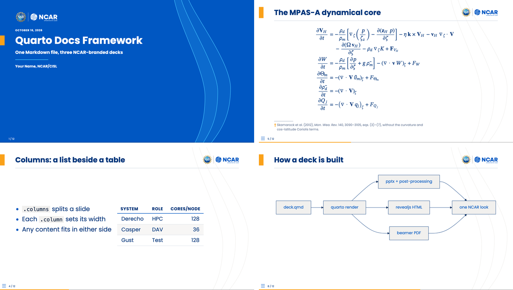
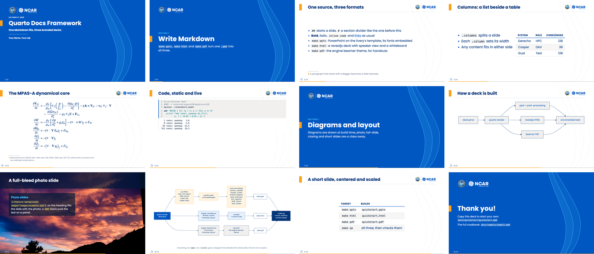
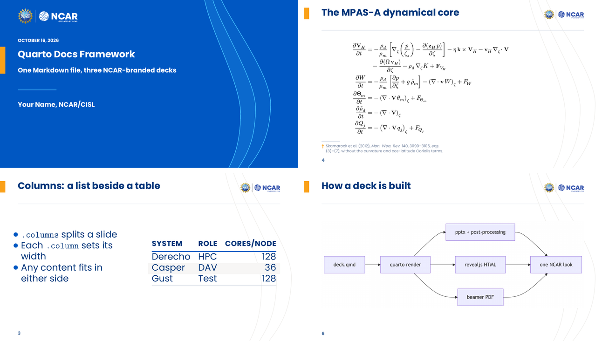

# quarto-livery-decks

> `quarto-livery-decks` is the multi-brand successor of
> [`benkirk/quarto-docs-framework`](https://github.com/benkirk/quarto-docs-framework), the
> same deck framework driven by brand "liveries" instead of one baked-in brand
> ([design](docs/design/engine-and-liveries.md)).

A [Quarto](https://quarto.org) framework for documentation decks in any brand: one
Markdown file becomes a branded PowerPoint (`.pptx`, the first-class output), a
revealjs HTML deck and a beamer PDF. The brand is a **livery**, a directory of data
and assets; `make pptx LIVERY=cu` is the whole switch. Three ship here: `ncar`
(NSF NCAR), `cu` (University of Colorado Boulder) and `nsi` (the CU Center for
National Security Initiatives). Clone, set up the conda env, copy the quickstart
deck, write Markdown.



The same quickstart deck under each livery (title, divider, content, closing):


Two example decks ship with the framework:

- **`docs/quickstart/`** is twelve slides, one of each headline feature. It is the deck to
  copy when you start your own (see "What you get" below).
- **`docs/sample/`** is a **cookbook** showing one example of every capability you're
  likely to need: text formatting, math, tables, two-column layouts, image embeds,
  syntax-highlighted code, auto-captured shell output, mermaid diagrams, speaker notes,
  and the `` shortcode. `docs/sample/old.qmd` is preserved as a richer
  real-world example (database schema / REST API / deployment diagrams).

## Quick start

```bash
git clone https://github.com/benkirk/quarto-livery-decks.git
cd quarto-livery-decks

# 1. Build the conda env (also installs + registers the bash Jupyter
#    kernel so executable {bash} chunks work).
make conda-env
conda activate ./conda-env

# 2. Render the quickstart deck.
cd docs/quickstart
make pptx              # → quickstart.pptx (the ncar livery, fonts embedded)
make html              # → quickstart.html (revealjs)
make pdf               # → quickstart.pdf  (beamer; needs TeX)
make pptx LIVERY=cu    # the same deck in CU Boulder's brand (also nsi)
```

Open `quickstart.pptx` (or `quickstart.html` in a browser), then copy
`quickstart.qmd` into a new deck directory and edit it (see "Adding a new deck"
below). When you need a pattern the quickstart deck lacks, `docs/sample/sample.qmd`
probably has it.

**Behind a restrictive proxy** (some cloud containers): if `quarto install
tinytex` cannot download, a system TeX Live works instead (`apt-get install
texlive-xetex texlive-latex-extra texlive-fonts-extra`). If `quarto install
chrome-headless-shell` cannot download, point Quarto at any Chromium with
`export QUARTO_CHROMIUM=/path/to/chrome`, and `make qa` at it with `CHROME`.

## What you get

Every slide of `docs/quickstart/quickstart.qmd`, in the HTML deck:



| Slide | The Markdown behind it |
|---|---|
| [Section divider](docs/quickstart/screenshots/02-divider.png) | `# Write Markdown`, then a paragraph: the subtitle |
| [Bullets and a footnote](docs/quickstart/screenshots/03-text.png) | a list, then a paragraph starting with `†`; `{.vcenter scale="1.2"}` on the heading |
| [Columns](docs/quickstart/screenshots/04-columns.png) | `:::: {.columns}` with a list in one `.column` and a table in the other |
| [Equations](docs/quickstart/screenshots/05-math.png) | LaTeX between `$$`: OMML in pptx, MathJax in HTML, real TeX in the PDF |
| [Code, static and live](docs/quickstart/screenshots/06-code.png) | a ` ```bash ` block, and a ` ```{bash} ` cell run at render time |
| [Diagram](docs/quickstart/screenshots/07-mermaid.png) | a ` ```{mermaid} ` cell (Graphviz ` ```{dot} ` works the same way) |
| [Photo slide](docs/quickstart/screenshots/08-feature.png) | `{.feature background-image="..."}`, the text in a `###` block |
| [Full-slide diagram](docs/quickstart/screenshots/09-full.png) | `{.full}` on the heading: one diagram or image, then an optional caption paragraph |
| [Short slide](docs/quickstart/screenshots/10-short.png) | `{.center scale="1.4"}` on the heading |
| [Closing](docs/quickstart/screenshots/11-closing.png) | `## Thank you! {.closing}` |

The same source as a beamer PDF (`make pdf`):



The pptx is the same deck again, on the livery's PowerPoint template. To refresh these
images after editing the deck, run `make screenshots` in `docs/quickstart/` (the ncar
shots) and `make gallery` (the livery rows); both need everything `make qa` does (see
"Checking a deck").

## Layout

```
quarto-livery-decks/
├── Makefile               # top-level: `make conda-env`, env mgmt, `make vendor-engine`
├── conda-env.yaml         # quarto + jupyter + bash_kernel + helpers
├── docs/
│   ├── Make.common        # shared per-deck recipes (pptx/html/pdf/qa/site/overleaf/clean)
│   ├── common/
│   │   ├── _quarto.yml    # shared Quarto config (symlinked into decks)
│   │   ├── _extensions/benkirk/engine/  # the engine (vendored theme; symlinked into decks):
│   │   │                                #   the beamer and revealjs themes, the livery tools
│   │   ├── liveries/           # the brands, one directory each (`make LIVERY=<name>`):
│   │   │   ├── ncar/           #   a link to the engine's reference livery
│   │   │   ├── cu/             #   CU Boulder: _brand.yml, livery.yml, fonts/, logos/, art/,
│   │   │   │                   #     template.pptx (generated), build/ (generated, committed),
│   │   │   │                   #     reference/notes.md (its decisions)
│   │   │   └── nsi/            #   CU NSI, a flavor of cu (extends: cu)
│   │   ├── *.lua               # pandoc filters for pptx (see "pandoc pptx gotchas" in CLAUDE.md)
│   │   └── utils/
│   │       ├── livery.py           # the engine's livery reader, loaded from the vendored engine;
│   │       │                       #   `livery.py deps <dir>`: the livery files a build reads
│   │       ├── livery_check.py     # the engine's livery checks, plus --qa
│   │       ├── livery_inspect.py   # reports on a reference pptx, seeds a livery (onboarding)
│   │       ├── deck_qa.py          # `make qa`: overflow, slide counts, contact sheets
│   │       ├── site_index.py       # `make site`: the index page
│   │       ├── parity.sh           # snapshots every deck under every livery, before and after
│   │       └── *.py                # the pptx post-render steps ("Build pipeline" below)
│   ├── quickstart/                 # the short exemplar deck: copy this one
│   │   ├── quickstart.qmd
│   │   ├── screenshots.py  (make screenshots: the README images)
│   │   ├── gallery.py      (make gallery: the livery rows above)
│   │   └── screenshots/    (those images, committed)
│   ├── fixtures/                   # photo.qmd and light.qmd: the photo and light titles,
│   │                               #   for parity.sh and CI
│   └── sample/                     # the cookbook deck
│       ├── Makefile        (3-line include of ../Make.common)
│       ├── _quarto.yml     (symlink → ../common/_quarto.yml)
│       ├── _extensions     (symlink → ../common/_extensions, made by make)
│       ├── _engine         (symlink → ../common, made by make)
│       ├── _livery         (symlink → the livery in use, made by make)
│       ├── sample.qmd      (the cookbook)
│       ├── old.qmd         (richer real-world example, kept for reference)
│       └── images/         (drop your PNGs / JPGs here)
└── conda-env/              # local conda prefix, gitignored
```

The liveries: `ncar` links to the engine's reference livery (NSF NCAR: the 2026
brand palette, Poppins, the NSF NCAR lockup, the wave super-graphic). `cu` is the
University of Colorado Boulder: the CU palette, TeX Gyre Heros and Heros Condensed
standing in for Helvetica Neue in HTML and PDF, the pptx naming Helvetica Neue
unembedded, CU's own vector lockup as a sign-off bottom-left with the page number
bottom-right; its `reference/notes.md` records the decisions. `nsi`, the CU Center for
National Security Initiatives, is a flavor of `cu` (`extends: cu`) with the center's
mark top left, the Research & Innovation Office lockup as its sign-off, its master
deck's band title (black field, constellation picture, gold band with the campus
photo, the two lockups beneath) and its satellite photo behind content slides. A new
livery drops in as a sibling directory and CI builds the quickstart deck under it
("Adding a livery" below).

## Build pipeline

Per deck, `make pptx` runs:

1. `quarto render <deck>.qmd --to pptx -o <deck>.pptx`, with
   `reference-doc: _livery/template.pptx` (the `ncar` livery unless `make LIVERY=<name>`)
   from the deck's `_quarto.yml`, so the output inherits the livery's theme colors,
   layouts and masters.
2. `section_subtitle.py`: merges the paragraph after a `#` section heading back onto the
   Section Header slide as its subtitle (pandoc drops it onto a separate untitled slide),
   then dresses every divider as the HTML and PDF decks draw it: the livery's "SECTION n"
   label, its tab, the block centered and measured in the livery's fonts. The field, logo
   and waves come from the template's Section Header layout (see "Template constraints").
3. `enable_autofit.py`: flips every body placeholder from "Do not Autofit" to "Shrink text
   on overflow" (see "About text autofit").
4. `embed_fonts.py`: re-injects the livery's four font variants as `<p:embeddedFont>`
   entries, which pandoc strips, so the font travels with the file. A livery without font
   blobs (cu names an installed face) is left alone.
5. `style_footnotes.py`: restyles body paragraphs that start with `†` or `‡` as footnotes
   (smaller, the livery's muted color, the marker in its accent), since pandoc ignores
   inline size and color. HTML and PDF go further: the theme moves them to the slide's foot.
6. `link_captions.py`: captions each linked picture (see "Linked images") with its URL,
   bottom center, muted; the caption box is itself the link.
7. `slide_layout.py`: applies a slide's layout controls (see "Centering and scaling a
   short slide"), which `common/slide-layout.lua` leaves as a speaker-notes line because
   pandoc drops slide classes; builds the photo covers; points closing and light title
   slides at the template's extra layouts.
8. `style_tables.py`: styles every table as the HTML theme does (a bold capitalized header
   over a rule in the primary color, thin rules between rows, every second row banded, the
   blends from `livery_build.py`); pandoc always writes "Medium Style 2", so the look is set
   cell by cell, and evenly split columns are re-split by content.

`make html` (revealjs) and `make pdf` (beamer) bypass steps 2 through 8 — the
template, fonts, autofit, and the other pptx fix-ups are pptx-specific.

### Linked images

Wrap an image in a link and the picture opens that page, in every format:

```markdown
[{height="72%" fig-align="center"}](https://example.org/dashboard)
```

Each format also shows the URL, small and muted, so a reader knows the
picture is live: the slide footer in HTML, a line at the foot of the PDF page
(`common/linked-images.lua`), and a caption box in pptx (`link_captions.py`;
pandoc can't add one without splitting the slide). One line per slide, from
its first linked image. `{height="72%"}` is the full-width screenshot recipe
and fits all three.

### Centering and scaling a short slide

Six per-slide controls on the heading, each independent, act on the body
(everything but the title, speaker notes and footnotes). They come from the
vendored theme (>= 2.5.0); pptx gets them through step 7.

```markdown
## Who's still on legacy {.center scale="1.4"}
## A short script {.hcenter .fill}
```

| Control | HTML | PDF | pptx |
|---|---|---|---|
| `.hcenter`: center the body across as a block | yes | prose, lists, plain code (a table centers anyway) | no |
| `.vcenter`: center it between the title and the floor | yes | yes | text yes; a table to an estimated center |
| `.center`: both (the theme's, not Quarto's) | yes | yes | as `.vcenter` |
| `scale="S"`: text, tables and code × S | yes (autofit still shrinks an overshoot) | yes (no autofit: check the page) | yes |
| `.fill`: grow until it just fits, up to 3× | yes | no; add `scale=` | no; add `scale=` |
| `.caution`: the body on a soft field with a bar in the warning color, for warning slides (theme >= 2.8.0) | yes | yes | yes; the box cut to an estimate of its text, footnotes inside it |

### PDF (beamer)

`make pdf` renders with `--to engine-beamer`. That format comes from the engine's
beamer theme ([benkirk/beamer-livery-theme](https://github.com/benkirk/beamer-livery-theme)),
which is vendored in `docs/common/_extensions/benkirk/engine/`. Make symlinks
`_extensions` into each deck directory, just as it does for `_quarto.yml`.

- **You need Quarto 1.6 or newer** (the conda env pins it): the theme's Lua
  filter uses a pandoc macro that older Quarto releases lack.
- **You need TeX with XeLaTeX.** Quarto's own TinyTeX (`quarto install
  tinytex`) works and installs missing LaTeX packages on the fly. So does a
  system TeX Live. (Plain-LaTeX decks, not Quarto ones, can also be written
  on Overleaf: see "LaTeX and Overleaf" below.)
- **No fonts to install.** Every livery bundles its fonts and logos.
- **Theme options** go in a deck's front matter:
  `themeoptions: [title=light, fonts=bundled]`. A deck-level
  list replaces the shared one, so keep `fonts=bundled` (from the shared
  `_quarto.yml`): it pins the livery's bundled fonts and never probes for a
  system copy. A livery whose brand font cannot be bundled may name it
  (cu: Helvetica Neue); `fonts=brand` then uses it where it is installed,
  see "Installed brand fonts" below.
  - `titlegraphic: images/photo.jpg` puts a photo on the title slide, behind
    the wave band, in every format (the livery's `title-photo` composition).
    A livery may set a default (`art.titlegraphic`; nsi's campus photo).
  - `fineprint: "..."` adds small print under the title block.
  - `mathfont=stix` (or `lm`, `pagella`, `sans`, `fira`, `poppins`, any
    OpenType math font) changes the math font; the default is New Computer
    Modern Math, scaled to sit with the text font. Quarto's own `mathfont:` key
    still works. The theme README shows every preset on one slide.
  - `waves=false` removes the faint wave lines behind content slides of a
    livery that has them (they are on the pptx master too).
- **Markdown extras:**
  - `## Title {.feature background-image="images/photo.jpg"}` makes a
    full-bleed photo slide (`background=` also works; `background-image=`
    doubles as the revealjs background). Its look is the livery's `feature.style`:
    `bar` (the title on a dark bar, the text on a translucent panel; the default) or
    `cover` (the title cover's field and waves, the photo beside them), in every format.
  - `## Title {.full}` gives one diagram or image the whole slide: no title,
    logo or rule, and the paragraph after it becomes a one-line caption. The
    title stays in the source for navigation and `make qa`. pptx gets it
    from `slide_layout.py`.
  - `## Thank you! {.closing}` makes a closing slide.
  - `### Heading {.example}` / `{.alert}` give block variants.
  - `[text]{.alert}` emphasizes text.
- **Beamer never shrinks overflowing text.** The shared config uses 10pt,
  which matches the pptx template's text density. Add `{.shrink}` to a dense
  slide's heading to scale that one slide down; pptx ignores the class.
- **To update the theme:** `cd docs/common && quarto update benkirk/beamer-livery-theme`.

### LaTeX and Overleaf

Every livery is also a pure-LaTeX beamer theme, with no Quarto in the loop. Each
release of this repo carries one project zip per livery: the theme's `.sty`, the
livery's fonts, logos and art, a `latexmkrc`, and a starter `talk.tex` on
`\usetheme[livery=liveries/<name>, fonts=bundled]{Engine}`. One click opens it
as a new Overleaf project (set the compiler to XeLaTeX if it asks):

| livery | | |
|---|---|---|
| `ncar` | [**Open in Overleaf**](https://www.overleaf.com/docs?snip_uri=https://github.com/benkirk/quarto-livery-decks/releases/latest/download/ncar-overleaf.zip&engine=xelatex) | [ncar-overleaf.zip](https://github.com/benkirk/quarto-livery-decks/releases/latest/download/ncar-overleaf.zip) |
| `cu` | [**Open in Overleaf**](https://www.overleaf.com/docs?snip_uri=https://github.com/benkirk/quarto-livery-decks/releases/latest/download/cu-overleaf.zip&engine=xelatex) | [cu-overleaf.zip](https://github.com/benkirk/quarto-livery-decks/releases/latest/download/cu-overleaf.zip) |
| `nsi` | [**Open in Overleaf**](https://www.overleaf.com/docs?snip_uri=https://github.com/benkirk/quarto-livery-decks/releases/latest/download/nsi-overleaf.zip&engine=xelatex) | [nsi-overleaf.zip](https://github.com/benkirk/quarto-livery-decks/releases/latest/download/nsi-overleaf.zip) |

The same zip, unzipped, is the local path: `latexmk -xelatex talk.tex` builds it
with nothing but XeLaTeX. To pack one yourself: `make overleaf LIVERY=cu` in any
deck directory writes `cu-overleaf.zip`, with the engine's `overleaf_zip.py`; a repo
that uses this framework packs its own livery with `make overleaf LIVERY_DIR=<dir>`.
The starter always uses the bundled fonts: a livery that prefers an installed face
(`installed-fonts`) would probe the system by name, which is too slow for a free
Overleaf compile. The engine's own reference liveries (ucar, ucp, ncar-ucar) have
their link in the [theme README](https://github.com/benkirk/beamer-livery-theme#overleaf).

The zips are attached by `release.yml` when a `v*` tag is pushed, by hand after a
livery change; CI (`ci-liveries.yaml`) compiles each livery's zip in a clean
directory on every push.

### HTML (revealjs)

`make html` renders with `--to engine-revealjs`, the web format from the same
vendored extension. The deck looks like the PDF: title slide with the livery's
art (or `titlegraphic:`), section dividers with subtitles, content slides
with the accent tab and logo, `.feature` and `.closing` slides. The same
`themeoptions:` apply (`title=`, `waves=`; math in the browser is
MathJax's, so `mathfont=` does not). Open `<deck>.html` in a browser
and keep `<deck>_files/` beside it.

- **Presenting:** `s` speaker view (notes), `m` slide menu, `b`/`c`
  whiteboard / draw on the slide, `f` full screen.
- **HTML-only extras:**
  - `## Title {.brand-dark}` puts a content slide on the livery's dark color with
    white text; pptx and PDF draw an ordinary slide.
  - Overflowing content slides shrink to fit (see "About text autofit").
  - Mermaid and Graphviz draw live in the browser; mermaid uses the livery's
    colors and font, not the baked-PNG look of pptx/PDF.
- **One file to share:** in a deck's front matter,
  ```yaml
  format:
    engine-revealjs:
      embed-resources: true
      chalkboard: false     # the whiteboard can't be embedded
  ```
  gives a single self-contained `.html`.
- **PDF from the browser:** open `<deck>.html?print-pdf` in Chrome and print
  with background graphics. `make pdf` is usually the better handout.

## Checking a deck

`make qa` builds every format, then checks the outputs (`docs/common/utils/deck_qa.py`):

- **Failures:**
  - slide counts that differ between pptx, PDF and HTML;
  - PDF text past the right margin, into the footer, overlapping other text, or running into
    the next table column;
  - HTML content past the right edge;
  - a bare `<word>` in the sources, outside code and backticks: revealjs reads it as a tag
    (reported as `file:line`).
- **Hints:**
  - short slides, with the share of the body they use;
  - `.smaller` without `.fill`;
  - slides the HTML autofit had to shrink.
- **Plain names:** list names that belong in backticks in `qa-names.txt` (one per line) in
  the deck directory, and every plain-text use is reported.

Everything lands in `_qa/` (gitignored): `report.txt`, `usage.tsv`, a contact sheet per
format, and per-slide PNGs. In a directory with several decks, `make qa DECKS=name`
checks one.

The checks need poppler, Pillow and Playwright, which are all in `conda-env.yaml`.
`make conda-env` installs Playwright's headless Chromium; set `CHROME` to use another
build. Without Playwright the HTML checks are skipped and the rest still run. For Claude
Code, the `deck-polish` skill (`.claude/skills/`) covers what to do with the findings.

## Publishing the HTML decks

`make site` gathers the HTML decks of a directory into `_site/` (gitignored), a static
site that works as is: `python3 -m http.server -d _site`. Every deck's `<deck>_files/libs/`
is a subset of one union, so the site keeps a single `libs/` and rewrites the references
(a 13-deck directory goes from ~140 MB to ~16 MB); `images/` ships beside the decks, and
`index.html` lists them by their front matter, first deck first, in the livery's colors
and font (its files copied to `fonts/`, so the page needs no font CDN).

`make publish` pushes `_site/` to a GitHub Pages branch. The branch is a build artifact,
not a record: each publish replaces it with **one** parentless commit, so nothing
accumulates however often you publish (Pages serves the branch tip and keeps no versions
of its own). The price is that every publish uploads the whole site, since a commit with
no parent gives git nothing to delta against. Enable Pages once, from the branch:

```bash
gh api -X POST repos/<owner>/<repo>/pages \
  -f build_type=legacy -f 'source[branch]=gh-pages' -f 'source[path]=/'
```

Settings go in the deck Makefile, before the include:

```make
DECKS          := samuel 1-overview 2-concepts
SITE_EXTRA     := companion                # directories of hand-written pages, listed on the index
SITE_NOINDEX   := 1                        # <meta name="robots" content="noindex"> on every page
PUBLISH_PREFIX := presentations/samuel     # path under the Pages root (default: the root)
PUBLISH_BRANCH := gh-pages                 # default
PUBLISH_REMOTE := origin                   # default
include ../framework/docs/Make.common
```

Two things to know: branch-based Pages is soft-limited to 10 builds an hour, and each push
shows in the repo's Actions tab as GitHub's own `pages-build-deployment` run. A public repo
publishes to a public URL; `SITE_NOINDEX` keeps it out of search engines, nothing more.

## Adding a new deck

```bash
cd docs
mkdir roadmap && cd roadmap

cat > Makefile <<'EOF'
include ../Make.common
EOF

# then author roadmap.qmd. _quarto.yml is auto-symlinked from
# ../common/_quarto.yml on first `make` invocation.
make pptx
```

`Make.common` infers the deck name from `$(notdir $(CURDIR))`, so the
output file is `<dirname>.pptx`. Override with `OUT=foo` if needed.

A directory can hold several decks that share images and fragments, e.g. a
full deck plus one deck per part:

```make
DECKS := roadmap 1-intro 2-details
include ../Make.common
```

Each `<name>.qmd` builds `<name>.pptx` / `.html` / `.pdf`, and `make pptx`
builds all of them. Put shared slide bodies in `_*.qmd` fragments and pull
them in with ``; quarto skips underscore files
when rendering, and make treats every `_*.qmd` and `data/*` in the directory
as a prerequisite of every deck, so editing one rebuilds them all.

A deck that needs custom Quarto config (a different reference template,
extra extensions, etc.) can replace the symlinked `_quarto.yml` with a
real file — `make` sees the file already exists and skips the symlink
recipe.

## Adding a livery

A livery is a brand as a directory of data and assets (`docs/design/engine-and-liveries.md`,
sections 4 and 6; `docs/common/liveries/cu/` is the worked example, its `reference/notes.md`
the decisions it took; the theme README's "Liveries" section lists every knob). From a
reference PowerPoint to a deck in the new brand:

1. **Inspect the reference deck.** `python3 docs/common/utils/livery_inspect.py <deck.pptx>
   docs/common/liveries/<name>` writes `reference/report.md` (slide size, theme slots, fonts,
   layouts and placeholders, the colors by frequency, the media) and seeds `_brand.yml` and
   `livery.yml`. The deck itself stays out of git.
2. **Decide the data.** `_brand.yml` (the brand.yml standard): the palette with the brand's
   names, `primary`/`secondary`/`foreground`/`background`, the font files (free, bundleable:
   a brand's proprietary face is named in the pptx and stood in for elsewhere), the light and
   dark logos. `livery.yml` (engine knobs): the roles (`primary-text`, `primary-contrast`,
   `accent`, `highlight`, `muted`, `surface`, `warning`, `dark`), the geometry (copy ncar's
   fractions, set the lockup's `aspect` and the marks' corners), a `signoff` lockup if the
   brand wants one at the foot, `marks` when a field needs another mark than the defaults
   (`background` wears `logo.medium.light`, `primary` the dark one, every other field
   primary's), `title: {style: band, ...}` for a band title instead of the cover (nsi),
   `art` (wave curves, or a picture per slide kind, or nothing; `titlegraphic` for a default
   title photo), `pptx.typeface`, `installed-fonts` for a proprietary brand face, and
   `extends:` for a flavor of another livery. `livery_build.py` warns about a key it does
   not know. Write the judgement calls into `reference/notes.md` as you make them.
3. **Build.** `python3 docs/common/_extensions/benkirk/engine/livery_build.py
   docs/common/liveries/<name>` resolves everything into `build/livery.{json,sty,css,theme}`;
   `python3 docs/common/_extensions/benkirk/engine/livery_template.py docs/common/liveries/<name>`
   generates `template.pptx` from it. Rerun both after any change; never edit the template by hand.
4. **Check.** `python3 docs/common/utils/livery_check.py docs/common/liveries/<name> --qa`:
   build freshness, every file the data names, the template's pandoc compliance and that it
   rebuilds from the data, contrast warnings for the small-text roles, then the quickstart
   deck's `make qa` under the livery.
5. **Look.** `make -C docs/quickstart pptx html pdf LIVERY=<name>`; open the pptx in
   PowerPoint (the "Repair?" prompt cannot be automated), the HTML in a browser, the PDF.
   `make -C docs/quickstart overleaf LIVERY=<name>`, unzip it somewhere clean and
   `latexmk -xelatex talk.tex`: the pure-LaTeX path. Commit `build/`, `template.pptx`, the
   assets and the notes. CI builds the quickstart under every livery directory and compiles
   its Overleaf zip, so the new one is checked from its first push.
6. **Release.** Add the livery's row to "LaTeX and Overleaf" above and `make gallery`
   it into the README, then cut a release: a new tag, or the current one moved
   (`git tag -f v1.0.0 && git push -f origin v1.0.0`) while a change stays backwards
   compatible. The release workflow attaches one zip per livery, replacing an existing
   release's, and the Overleaf links serve the latest.

## Using the framework from another repo

A project can keep its decks in its own tree and take this framework as a git
submodule, pinned to a commit. Its decks then live wherever it likes, and
nothing of the project's goes into this repo.

```bash
git submodule add https://github.com/benkirk/quarto-livery-decks.git docs/presentations/framework
mkdir docs/presentations/roadmap && cd docs/presentations/roadmap
echo 'include ../framework/docs/Make.common' > Makefile
# author roadmap.qmd, then
make -C ../framework conda-env    # once: the framework's own environment
make pptx                         # or: make pptx LIVERY=cu
```

- **Include `Make.common`, by a path relative to the deck directory.** It finds
  everything else from that path. A symlink to it would not work: the path
  would be the link's own directory.
- **Make links the rest into the deck directory on the first build:**
  `_quarto.yml`, `_extensions`, `_engine` (this repo's `docs/common/`, which
  the shared `_quarto.yml` reaches its filters through) and `_livery` (the livery in
  use, which it reaches the pptx template through). The consumer gitignores those
  links, and its build outputs.
- **A livery of its own**: a directory anywhere, built as in "Adding a livery", chosen
  with `make pptx LIVERY_DIR=path/to/livery`; `make overleaf LIVERY_DIR=...` packs its
  Overleaf zip, which the consumer releases itself.
- **Everything else works as it does here:** `DECKS`, `_*.qmd` fragments,
  `make qa` (with the deck's own `qa-names.txt`), `make site`, and a deck's own
  `_quarto.yml` in place of the link.
- **Activate the framework's environment to build**, as in Quick start:
  `conda activate <path>/framework/conda-env`. It lives in the submodule and is
  gitignored there.
- **A framework fix goes here first.** Merge it here, then move the
  consumer's pin (`git -C docs/presentations/framework pull`, then commit the
  new pointer). The engine follows the same path one level down.
- **The deck-polish skill:** a consumer can link
  `.claude/skills/deck-polish` to `docs/presentations/framework/.claude/skills/deck-polish`.

CI checks this layout on every pull request
(`.github/workflows/ci-consumer.yaml`). It checks the framework out at
`consumer/docs/presentations/framework`, writes a hello-world deck beside it,
and builds all three formats from there.

## Executable shell chunks

Quarto can capture the live output of a shell command at render time:

````markdown
```{bash}
#| echo: true
which mpicxx && mpicxx --version
```
````

Both the command and its captured stdout land on the slide. This needs
the Jupyter `bash` kernel, which `make conda-env` installs and registers
into the env (`bash_kernel` pip package + `python -m bash_kernel.install
--sys-prefix`). The deck's frontmatter must opt in:

```yaml
engine: jupyter
jupyter: bash
```

Code runs on the build host, not the viewer's machine — output is baked
into the .pptx.

## Text sizes and the slide size

Each livery states its text sizes in whole or half points on its PowerPoint canvas, from the
brand's own template or deck. ncar uses the NSF NCAR template's 10 x 5.625 in slide, with a 12 pt
body, 12/11/10/9/8 pt list levels, 20 pt slide titles and a 22 pt cover title. cu uses the NSI
deck's 13.33 x 7.5 in slide, with a 16 pt body, 32 pt titles and 60 pt dividers. So a slide
copied from a built pptx into a hand-made deck on that template keeps its geometry and its
round sizes. HTML and PDF set the same sizes as the same share of the slide, so a slide fits,
or overflows, alike in all three. `scale="S"` on a slide still sizes it in every format, and
PowerPoint's sizes round to the half point.

A whole deck can step its sizes down (or up) from the livery's, in all three formats:

```yaml
type-body: 10      # the body in points; every size scales by 10/12 under ncar
# type-scale: 0.85 # or a plain factor (type-body wins if both are set)
```

The NSF NCAR guide's "10 pts for three and four column layouts" is `type-body: 10`. PowerPoint
gets every size rounded to the half point (`type_step.py`, the recipe's last step), and a
slide's `scale=` still multiplies on top. In plain LaTeX or Overleaf, the theme option
`typescale=0.85` does the same. A livery's sizes live in its `livery.yml`
(`type:`, `pptx.size`; [beamer-livery-theme](https://github.com/benkirk/beamer-livery-theme)'s
README lists the roles).

## About text autofit

Pandoc's PPTX writer emits empty `<a:bodyPr/>` on every placeholder,
which corresponds to PowerPoint's "Do not Autofit" — long text overflows
the placeholder visually. `enable_autofit.py` rewrites these to
`<a:bodyPr><a:normAutofit/></a:bodyPr>`, which sets the dropdown to
"Shrink text on overflow."

Caveat: PowerPoint computes the actual `fontScale` only on edit, not on load, so the
file still opens with overflowing text; a click into any overflowing cell triggers the
recompute and the text shrinks permanently. Author-side discipline (split walls of text,
use columns) beats driving PowerPoint externally, so nothing is wired up for that.

The HTML deck fits itself: a content slide that runs past the bottom margin
shrinks its body text (down to 65%) until it fits, keeping the title size.
`{.smaller}` still sets a slide smaller from the start:

```markdown
## Wall of text {.smaller}
```

PPTX silently ignores `{.smaller}`; revealjs honors it. Opt a slide out of
the HTML autofit with `{.no-autofit}` (or `{.scrollable}`), or a whole deck
with `themeoptions: [autofit=false]`.

## Template constraints

Each livery's `template.pptx` is generated by the engine's `livery_template.py`
(`docs/common/_extensions/benkirk/engine/`) from the livery's data (`build/livery.json`:
theme slots, typeface, marks, geometry, wave curves); never edit it by hand, change the
livery and rerun the tool. It keeps the two things pandoc is strict about:

- **`slideLayout1` placeholders**: must include all five of `ctrTitle`,
  `subTitle`, `dt`, `ftr`, `sldNum`. Pandoc emits empty `<p:sp/>` stubs
  for any missing placeholder, which PowerPoint then flags as corrupt
  ("Repair?" prompt on open).
- **Layout names**: pandoc looks up layouts by display name. The title
  slide layout must be named exactly `Title Slide`; other layouts pandoc
  knows about are `Title and Content`, `Section Header`, `Two Content`,
  `Comparison`, `Content with Caption`, `Blank`. Missing names don't
  break the build but trigger a `Couldn't find layout named …` warning
  and fall back to pandoc's bundled layout (losing the brand's styling for that
  slide).
- **Placeholder indices**: pandoc matches content boxes by `idx` as well as
  type, so the date, footer and slide-number placeholders carry indices (20-22)
  no content box uses; a collision drops a column into the footer's box.
- **Two more layouts pandoc never picks**: `Closing` and `Title Slide (light)`.
  Pandoc copies every layout of the reference doc into the deck but chooses only
  by the names above (with two layouts of one name, pandoc 3.8 took the later
  one, undocumented, so we never rely on it). `slide_layout.py` points a
  `{.closing}` slide at `Closing`, and the title slide at `Title Slide (light)`
  when the deck's front matter sets `themeoptions: [..., title=light]`; in
  PowerPoint both are in the layout menu for slides added by hand.

Verify after any template change:

```bash
unzip -p docs/common/liveries/ncar/template.pptx \
  ppt/slideLayouts/slideLayout1.xml | grep -oE '<p:ph[^/]*/>'
# expect 5 matches
```

## About the fonts

The template's font scheme names the livery's typeface (`pptx.typeface`: Poppins for
ncar, Helvetica Neue for cu), so slide masters and layouts all dereference to it. Embedding
the font blobs on top of that (`pptx.fonts`, four `.fntdata` files) is only needed when the
`.pptx` will be opened on a machine without the font; without it, PowerPoint substitutes
(typically Calibri). A livery with no blobs (cu: a commercial face) relies on the viewer's
machine. If portability stops mattering, drop the `embed_fonts.py` step from `Make.common`.

### Installed brand fonts

Some brand faces are commercial and cannot ship in the repo or a published site: cu's
Helvetica Neue is Monotype's, so cu bundles TeX Gyre Heros (and Heros Condensed for
headings) and names the real face in `livery.yml`:

```yaml
installed-fonts:
  base: Helvetica Neue                  # a family: its four faces by the usual names
  headings:                             # or faces by full and PostScript name
    family: Helvetica Neue
    faces: {bold: [Helvetica Neue Condensed Bold, HelveticaNeue-CondensedBold],
            regular: [Helvetica Neue Condensed Bold, HelveticaNeue-CondensedBold]}
```

- **HTML**: each `@font-face` lists the installed face as `local()` sources ahead of the
  bundled file, so a viewer who has it (every Mac and iPhone) sees Helvetica Neue and anyone
  else Heros. Nothing is copied.
- **PDF**: a deck opts in with `themeoptions: [fonts=brand]`; the theme then loads the
  installed faces when the machine building the PDF has them and embeds them for every
  reader (built on Linux, it falls back to Heros). The shared `fonts=bundled`, CI, parity
  and the Overleaf zips ignore installed fonts, so their output never depends on the machine.
- **pptx**: nothing to do; the theme names `pptx.typeface` (Helvetica Neue) already.

The framework never copies the font. Embedding an installed font in a PDF you hand out is a
question for that font's licence: macOS's covers using its fonts, not redistributing the
files, which this never does; check before you publish a PDF built this way.

## License

Copyright © 2026 University Corporation for Atmospheric Research.

The framework, its tools and the example decks are licensed under
[CC BY-SA 4.0](https://creativecommons.org/licenses/by-sa/4.0/) (Creative
Commons Attribution-ShareAlike 4.0 International); the full text is in
[`LICENSE.txt`](LICENSE.txt). You may share and adapt them with attribution,
provided you distribute your changes under the same license. They are freely
available to anyone who wants to build decks, or a livery, of their own.

**Each livery's marks and pictures belong to their owner** and are not covered by that
license:

- **The NSF, NCAR, UCAR and UCP logos and brand marks** (`docs/common/liveries/ncar/` and
  the vendored theme) are trademarks used under the
  [UCAR brand guidelines](https://ucar.canto.com/v/branding).
- **The CU Boulder lockups, the NSI and Research & Innovation Office lockups, and the
  photographs** of the `cu` and `nsi` liveries are the University of Colorado's and its
  units', reproduced here as the livery's reference assets; see each livery's
  `reference/notes.md` for their sources.
- **The Poppins font** (`docs/common/liveries/ncar/fonts/` and the vendored theme)
  is licensed under the [SIL Open Font License](https://openfontlicense.org); **TeX Gyre
  Heros** (`docs/common/liveries/cu/fonts/`) under the GUST Font License.
