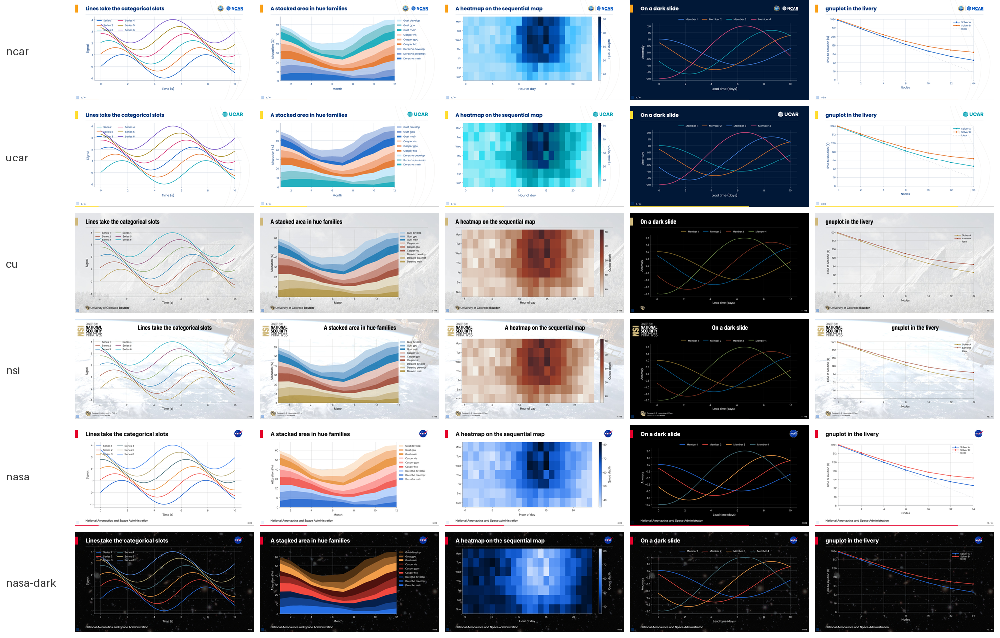
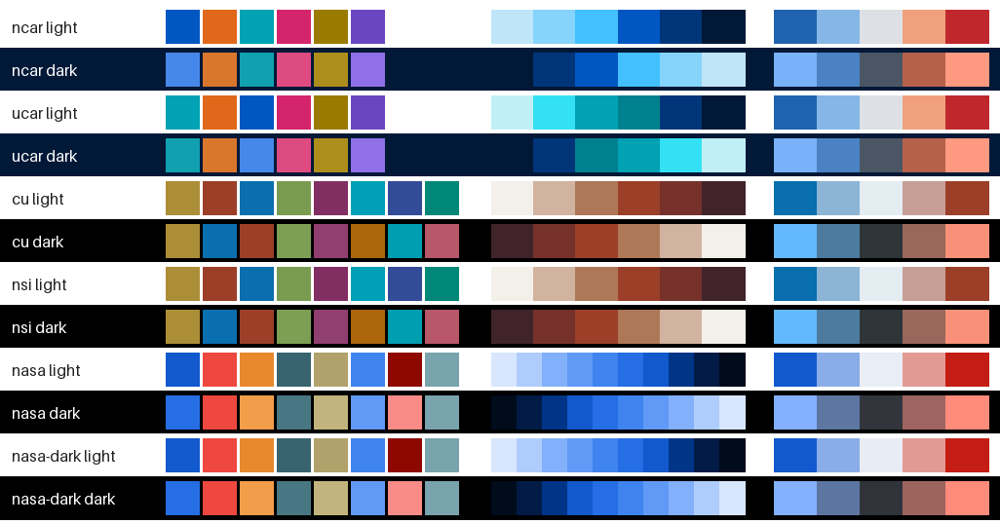

# Plots in the livery

`plots.qmd` is the cookbook for Python plots in a framework deck: matplotlib and seaborn in the
livery's chart colors, its font and the slide's own type sizes, in all three formats, with no
styling code. It shows lines, a seaborn bar chart from pandas, a stacked area in hue families, a
heatmap, a diverging field, two plots in columns, math in the labels, a dark slide. The design
and the color science are in [`design/charts-and-plots.md`](../../design/charts-and-plots.md).



## A deck with plots

````markdown
---
engine: jupyter
jupyter: python3
---

```{python}
#| include: false
import livery_mpl                  # the livery's fonts, colormaps and helpers
import matplotlib.pyplot as plt
```

## Throughput by month

```{python}
fig, ax = plt.subplots()           # the slide's content area: labels at the body size
ax.plot(months, jobs)              # the livery's first series color
plt.show()
```
````

`make pptx|html|pdf` does the rest. `Make.common` exports the livery's `build/livery.mplstyle`
as `MATPLOTLIBRC`, puts `livery_mpl` on `PYTHONPATH`, and gives the deck the content area as its
figure size, so a plot drawn at the default size has slide-sized text. The engine shows each
figure at the slide's scale in HTML and PDF, and pandoc does in pptx: plot text measures the
same as body text in every format.

## What the helper offers

| | |
|---|---|
| `livery_mpl.colors` | the categorical slots of the livery's mode, in order (the color cycle) |
| `livery_mpl.families` | up to 8 hues by 3 tints, for a large map where the hue names the group and the tint the member (the stacked-area slide) |
| `livery_mpl.status`, `.muted` | `good`, `warning`, `serious`, `critical`; the color for "Other" |
| `livery_mpl.figsize("half")` | one of two columns; `figsize("full", height=0.6)` a wide, short plot |
| `livery_mpl.shade_family(c, n)` | `n` tints of `c` toward the surface, as the families are built |
| `livery_mpl.surface`, `livery_mpl.mix(a, b, t)` | the background the plot sits on; `a` moved toward `b` by `t` in OKLab (a color between two, a tint toward the surface) |
| `with livery_mpl.dark():` | a `{.brand-dark}` slide: the dark chrome and colors, in every format (each draws that slide on the livery's dark role); `surface` is the dark one inside |
| `with livery_mpl.raster():` | the figures shown inside as PNG (200 dpi unless given) where the deck draws vector: one heavy time series, the rest of the deck still SVG. `plt.show()` inside the block |
| `with livery_mpl.dense():` | small multiples: every text size scaled together, by 0.65 unless given, to the half point (a 3 x 4 grid at the slide's sizes leaves no room for the data) |
| colormaps | `livery` (the default, the livery's own map), `livery_r`, `livery_div` (diverging), `livery_seq_<ramp>`, each with a `_dark` twin |
| `livery_mpl.use(path)` | another livery: a directory, or a charts bundle's |
| `livery_mpl.__version__` | the engine's version (a charts bundle's: the engine that packed it, also its `livery.json`'s `engine`) |

These are the helper's stable API (`livery_mpl.__all__` and the colormaps): a change to any of
them is a *Plots* entry in [`CHANGELOG.md`](../../CHANGELOG.md).

What breaks it: `sns.set_theme()` or `plt.style.use(...)` (they replace the livery's style), a
hand-picked `figsize` (it changes the text size; for smaller type, `dense()`), a colormap by name
such as `viridis`, more than eight series (fold the rest into "Other").

## A note under a plot

A summary line under a chart goes in a `::: note` after the cell (the seaborn slide has one), or
the cell prints it, which keeps the numbers live:

````markdown
```{python}
#| output: asis
fig, ax = plt.subplots(figsize=livery_mpl.figsize(height=0.9))   # room for the note
...
plt.show()
print(f"\n::: note\n{used} used of {size}.\n:::\n")
```
````

Every format sets it as the plot's caption: small, muted, centered, just under the plot
([docs/authoring.md "Notes under a figure"](../../docs/authoring.md#notes-under-a-figure)). Draw
the plot a little short of the content height (`height=0.9`) so the note fits the PDF, which has
no autofit.

## In each format

pptx gets SVG with a 200 dpi PNG beside it, as PowerPoint itself saves one: PowerPoint draws the
SVG, sharp at any zoom, and an app that ignores it shows the PNG (Google Slides' import). A deck
grows: the plots deck by 16%, a 33-plot report by 39%. HTML gets SVG with the text as paths (an
`` cannot see the page's fonts), PDF a vector PDF with the font embedded (Type 3 for a CFF
`.otf` family such as cu's TeX Gyre Heros, which matplotlib would otherwise mislabel). A deck whose
plots make heavy SVG can take PNG in HTML too ([docs/formats.md "HTML
(revealjs)"](../../docs/formats.md#html-revealjs)), or one plot can, inside `with
livery_mpl.raster():`, which makes it PNG in pptx too.

The same colors are `--engine-data-1..8`, `--engine-data-muted` and `--engine-status-*` in the
HTML deck, `EngineData1..8` (and a pgfplots `livery` cycle list, the default when a LaTeX document
loads pgfplots) in the PDF, and a **Custom Colors** row in every PowerPoint color picker of a
framework deck ("Data 1 · Blue", ...).

## The liveries' chart colors



Each row is one livery on its light or dark surface: the categorical slots (at most eight), the
default color map, the diverging scale. Where they come from (each livery's
`reference/notes.md`, "Chart colors"):

- **ncar, ucar** (and their flavors ucp, ncarucar): the series are sam-queries' validated sets
  for the NCAR brand. ucar's leads with UCAR Aqua. The maps run through the brand's own blues,
  Light Blue's tints to Space (ucar: along UCAR Aqua). The ramps are the UCAR web theme's tint
  ladders, re-based on the 2026 guide.
- **cu, nsi**: CU publishes no chart palette, so the engine generates one from CU Gold and Sky
  Blue, with the campus in it: the red tile roofs (`#9C3F29`, sampled from the campus photo) as
  the third color and a sage green the fourth, a campus map of Light Gold, the Flatirons' sandstone and the tile in sun and
  shade, and a diverging scale from the sky to the roofs.
- **nasa, nasa-dark, nasa-jsc-eg, nasa-ccp**: NASA's own dataviz palette from the Horizon Design System, verbatim.

The colors pass the dataviz checks (lightness band, chroma, separation under color blindness,
contrast on the surface). A palette the engine generates must pass. A brand's published palette
is kept as given, and its shortfalls are reported as warnings. `python3
_extensions/engine/livery.py check liveries/<name> --swatch DIR` prints the checks and draws a
livery's full contact sheet.

## Outside the decks

`make charts-zip LIVERY=<name>` (any deck directory) writes `<name>-charts.zip`: the style, the
helper, `livery.json`, the fonts and their licenses, and the contact sheet. Unzip it beside a
script, `import livery_mpl`, and its plots wear the livery. Every release attaches one per
livery: `releases/latest/download/<name>-charts.zip`. Its README and `livery_mpl.__version__`
name the engine that packed it, and its `livery.json` carries the same `engine` and `schema`
stamp as the livery's build.

Or install the helper with pip (Python 3.10 or later; it brings matplotlib) and hand it a
bundle's zip as it is:

```sh
pip install "livery-mpl @ git+https://github.com/benkirk/quarto-livery-decks@v26.10.11#subdirectory=_extensions/engine/mpl"
```

```python
import livery_mpl                         # installed: imports unconfigured, so use() first
livery_mpl.use("ncar-charts.zip")         # or a livery's directory, or an unpacked bundle
```

`use()` unpacks the zip once into `$XDG_CACHE_HOME/livery_mpl/` (else `~/.cache/livery_mpl/`),
again only when the zip is newer, and registers its fonts from there. Pin the release whose
bundles you use: `livery_mpl.__version__` is the release installed. The decks never install it:
`Make.common` puts the helper on `PYTHONPATH`.

## Rebuilding the images

`make gallery` here writes `screenshots/liveries.png` and `palettes.png` (committed). Rerun it
after a livery's charts change, look at the images, and commit them.
