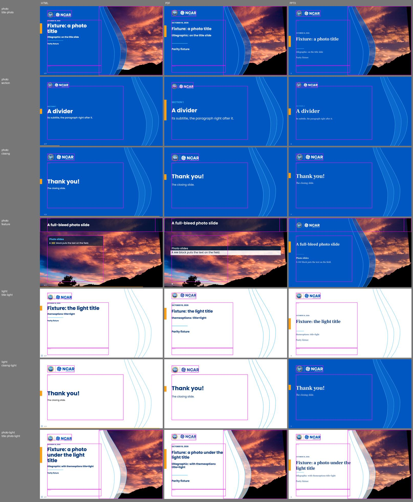
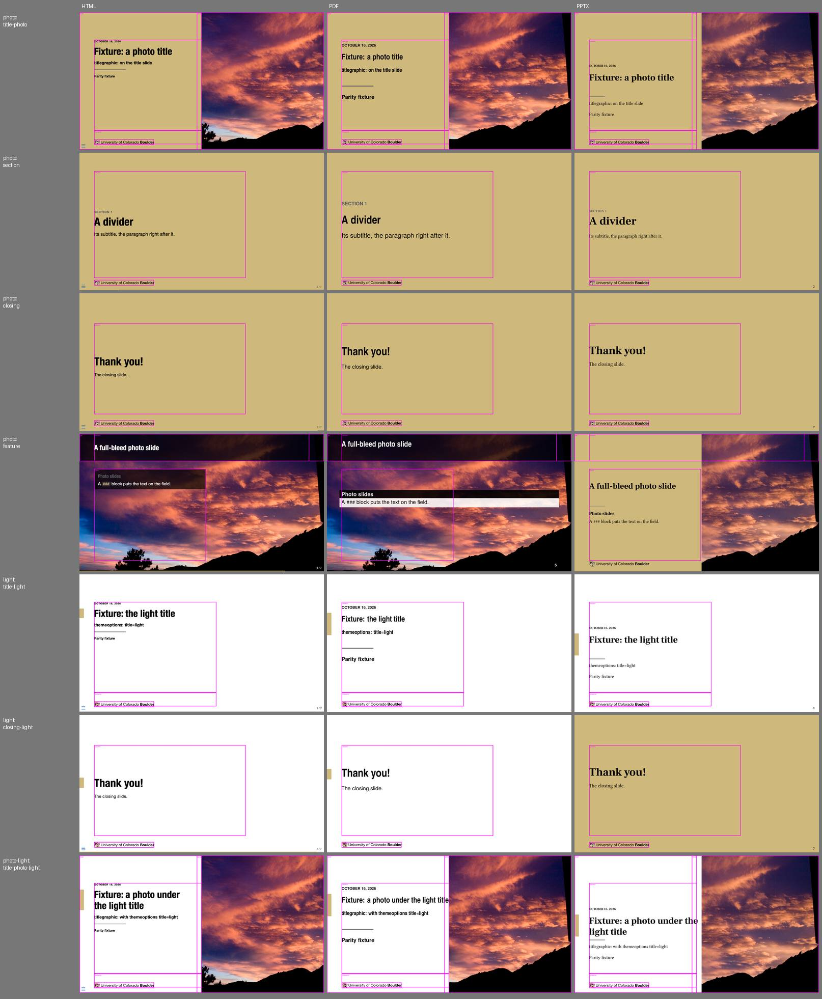
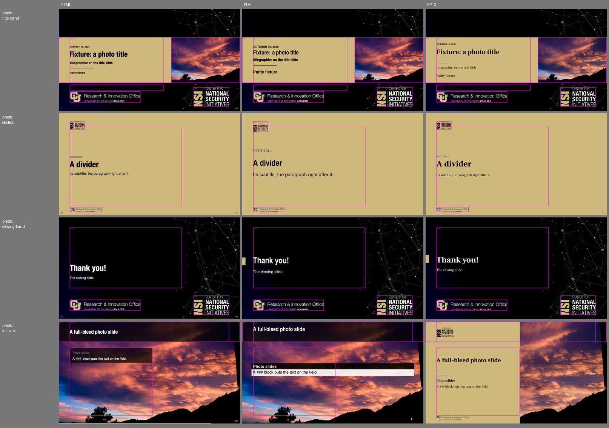

# Compositions: the before-picture

Measured 2026-10-17 by `make measure` (`docs/common/utils/comp_measure.py`) on `docs/fixtures`
(photo, light, photo-light) and `docs/quickstart`, under ncar, cu and nsi, with engine 3.4.0 plus
beamer-livery-theme #21-#23 (the compositions as data, read by no format yet). Each number is a
format's measured edge minus the composition's box, in fractions of the slide (0.01 is 16 px
across, 9 px down). **Bold** is over tolerance: 0.02 (0.03 for pptx's middle-anchored stacks),
0.005 for drawn edges; `right<=` only fails past the box; `-` is an edge the tool found nothing
at (the format draws no such box, or in another colour). A composition measured in several
decks shows its first. The contact sheets, with the boxes in magenta, are in
`compositions-baseline/`. Later PRs measure against this.

## ncar

| composition | box | edge | box value | HTML | PDF | pptx |
|---|---|---|---:|---:|---:|---:|
| title | column | left | 0.060 | +0.001 | +0.000 | +0.001 |
| title | column | right<= | 0.560 | +0.001 | -0.046 | -0.083 |
| title | column | top | 0.200 | +0.004 | **+0.030** | **+0.182** |
| title | mark | bottom | 0.150 | +0.016 | -0.009 | -0.006 |
| title | mark | left | 0.060 | +0.003 | +0.000 | +0.003 |
| title | mark | right | 0.259 | -0.007 | +0.000 | -0.002 |
| title | mark | top | 0.060 | **+0.022** | -0.008 | +0.004 |
| title-photo | column | left | 0.060 | +0.000 | +0.000 | +0.001 |
| title-photo | column | right<= | 0.500 | -0.120 | -0.117 | -0.094 |
| title-photo | column | top | 0.200 | +0.004 | **+0.030** | **+0.182** |
| title-photo | mark | bottom | 0.150 | +0.016 | -0.009 | -0.006 |
| title-photo | mark | left | 0.060 | +0.003 | +0.000 | +0.003 |
| title-photo | mark | right | 0.259 | -0.007 | +0.000 | -0.007 |
| title-photo | mark | top | 0.060 | **+0.022** | -0.008 | +0.004 |
| title-light | column | left | 0.060 | +0.001 | +0.000 | +0.001 |
| title-light | column | right<= | 0.560 | -0.077 | -0.166 | -0.139 |
| title-light | column | top | 0.200 | +0.006 | **+0.030** | **+0.182** |
| title-light | mark | bottom | 0.150 | +0.018 | -0.009 | -0.001 |
| title-light | mark | left | 0.060 | +0.002 | +0.002 | +0.001 |
| title-light | mark | right | 0.259 | -0.001 | +0.000 | -0.001 |
| title-light | mark | top | 0.060 | **+0.022** | -0.008 | +0.002 |
| title-photo-light | column | left | 0.060 | +0.001 | +0.000 | +0.001 |
| title-photo-light | column | right<= | 0.500 | -0.064 | -0.023 | -0.005 |
| title-photo-light | column | top | 0.200 | +0.006 | **+0.030** | **+0.182** |
| title-photo-light | mark | bottom | 0.150 | +0.018 | -0.009 | -0.003 |
| title-photo-light | mark | left | 0.060 | +0.002 | +0.002 | +0.001 |
| title-photo-light | mark | right | 0.259 | -0.001 | +0.000 | +0.001 |
| title-photo-light | mark | top | 0.060 | **+0.022** | -0.008 | +0.003 |
| section | column | centre | 0.522 | -0.009 | **-0.022** | -0.025 |
| section | column | left | 0.060 | +0.001 | -0.001 | +0.000 |
| section | column | right<= | 0.680 | -0.102 | -0.011 | -0.122 |
| section | mark | bottom | 0.160 | -0.006 | +0.018 | -0.004 |
| section | mark | left | 0.060 | +0.003 | +0.001 | +0.003 |
| section | mark | right | 0.237 | -0.007 | +0.001 | -0.002 |
| section | mark | top | 0.080 | +0.004 | **+0.023** | +0.004 |
| closing | column | centre | 0.550 | -0.016 | **-0.054** | **-0.057** |
| closing | column | left | 0.060 | +0.001 | +0.000 | +0.000 |
| closing | column | right<= | 0.680 | -0.261 | -0.165 | -0.066 |
| closing | mark | bottom | 0.190 | -0.006 | +0.012 | -0.003 |
| closing | mark | left | 0.060 | +0.004 | +0.002 | +0.004 |
| closing | mark | right | 0.281 | -0.009 | +0.001 | -0.003 |
| closing | mark | top | 0.090 | +0.006 | +0.012 | +0.002 |
| closing-light | column | centre | 0.550 | **-0.047** | **-0.074** | **-** |
| closing-light | column | left | 0.060 | +0.001 | +0.000 | **-** |
| closing-light | column | right<= | 0.680 | -0.361 | -0.362 | **-** |
| closing-light | mark | bottom | 0.190 | -0.001 | +0.012 | -0.003 |
| closing-light | mark | left | 0.060 | +0.002 | +0.002 | +0.004 |
| closing-light | mark | right | 0.281 | -0.001 | +0.001 | -0.003 |
| closing-light | mark | top | 0.090 | +0.002 | +0.013 | +0.002 |
| feature | bar | bottom | 0.200 | -0.001 | -0.001 | **-** |
| feature | column | centre | 0.100 | +0.004 | **-0.022** | +0.007 |
| feature | column | left | 0.060 | +0.001 | +0.001 | +0.011 |
| feature | column | right<= | 0.940 | -0.537 | -0.504 | -0.688 |
| feature | panel | left | 0.060 | +0.000 | **-** | **-** |
| feature | panel | right | 0.518 | +0.000 | **-** | **+0.018** |
| feature | panel | top | 0.256 | -0.001 | **-** | **-** |

The quickstart under ncar: `compositions-baseline/quickstart-ncar.jpg`.

## cu

| composition | box | edge | box value | HTML | PDF | pptx |
|---|---|---|---:|---:|---:|---:|
| title | column | left | 0.060 | +0.001 | +0.001 | +0.001 |
| title | column | right<= | 0.560 | -0.114 | -0.155 | -0.083 |
| title | column | top | 0.200 | +0.006 | **+0.030** | **+0.182** |
| title | signoff | bottom | 0.965 | -0.001 | -0.002 | +0.001 |
| title | signoff | left | 0.060 | +0.001 | +0.001 | +0.000 |
| title | signoff | right | 0.305 | -0.002 | +0.000 | -0.000 |
| title | signoff | top | 0.925 | +0.002 | -0.001 | +0.001 |
| title-photo | column | left | 0.060 | +0.000 | -0.001 | +0.001 |
| title-photo | column | right<= | 0.500 | -0.122 | -0.190 | -0.094 |
| title-photo | column | top | 0.200 | +0.006 | **+0.030** | **+0.182** |
| title-photo | field | right | 0.500 | -0.001 | -0.001 | **+0.019** |
| title-photo | signoff | bottom | 0.965 | -0.001 | -0.002 | +0.001 |
| title-photo | signoff | left | 0.060 | +0.001 | +0.001 | +0.000 |
| title-photo | signoff | right | 0.305 | -0.002 | +0.000 | +0.000 |
| title-photo | signoff | top | 0.925 | +0.002 | -0.001 | +0.001 |
| title-light | column | left | 0.060 | +0.000 | +0.000 | +0.001 |
| title-light | column | right<= | 0.560 | -0.170 | -0.242 | -0.139 |
| title-light | column | top | 0.200 | +0.006 | **+0.030** | **+0.182** |
| title-light | signoff | bottom | 0.965 | +0.001 | -0.001 | +0.001 |
| title-light | signoff | left | 0.060 | +0.000 | +0.001 | -0.001 |
| title-light | signoff | right | 0.305 | -0.002 | +0.000 | -0.000 |
| title-light | signoff | top | 0.925 | +0.001 | -0.001 | -0.001 |
| title-photo-light | column | left | 0.060 | +0.000 | +0.000 | +0.001 |
| title-photo-light | column | right<= | 0.500 | -0.090 | -0.005 | -0.005 |
| title-photo-light | column | top | 0.200 | +0.006 | **+0.030** | **+0.182** |
| title-photo-light | field | right | 0.500 | -0.001 | -0.001 | **+0.019** |
| title-photo-light | signoff | bottom | 0.965 | +0.001 | -0.001 | +0.001 |
| title-photo-light | signoff | left | 0.060 | +0.000 | +0.001 | -0.001 |
| title-photo-light | signoff | right | 0.305 | -0.002 | +0.000 | +0.000 |
| title-photo-light | signoff | top | 0.925 | +0.001 | -0.001 | -0.001 |
| section | column | centre | 0.522 | -0.009 | **-0.022** | -0.002 |
| section | column | left | 0.060 | +0.000 | -0.001 | +0.000 |
| section | column | right<= | 0.680 | -0.095 | -0.029 | -0.122 |
| section | signoff | bottom | 0.965 | -0.001 | -0.002 | +0.001 |
| section | signoff | left | 0.060 | +0.001 | +0.001 | +0.000 |
| section | signoff | right | 0.305 | -0.002 | +0.000 | +0.000 |
| section | signoff | top | 0.925 | +0.002 | -0.001 | +0.001 |
| closing | column | centre | 0.550 | -0.013 | **-0.056** | **-0.057** |
| closing | column | left | 0.060 | +0.000 | -0.001 | +0.000 |
| closing | column | right<= | 0.680 | -0.271 | -0.181 | -0.066 |
| closing | signoff | bottom | 0.965 | -0.001 | -0.002 | +0.001 |
| closing | signoff | left | 0.060 | +0.001 | +0.001 | +0.000 |
| closing | signoff | right | 0.305 | -0.002 | +0.000 | -0.000 |
| closing | signoff | top | 0.925 | +0.002 | -0.001 | +0.001 |
| closing-light | column | centre | 0.550 | -0.012 | **-0.076** | **-0.089** |
| closing-light | column | left | 0.060 | +0.000 | -0.001 | +0.000 |
| closing-light | column | right<= | 0.680 | -0.422 | -0.426 | -0.391 |
| closing-light | signoff | bottom | 0.965 | +0.001 | -0.001 | +0.001 |
| closing-light | signoff | left | 0.060 | +0.000 | +0.001 | +0.000 |
| closing-light | signoff | right | 0.305 | -0.002 | +0.000 | -0.000 |
| closing-light | signoff | top | 0.925 | +0.001 | -0.001 | +0.001 |
| feature | bar | bottom | 0.200 | -0.001 | -0.001 | **-** |
| feature | column | centre | 0.100 | +0.004 | **-0.022** | **-** |
| feature | column | left | 0.060 | +0.000 | +0.001 | **-** |
| feature | column | right<= | 0.940 | -0.615 | -0.594 | **-** |
| feature | panel | left | 0.060 | +0.000 | **-** | **-** |
| feature | panel | right | 0.518 | +0.000 | **-** | +0.003 |
| feature | panel | top | 0.256 | -0.001 | **-** | **-** |

The quickstart under cu: `compositions-baseline/quickstart-cu.jpg`.

## nsi

| composition | box | edge | box value | HTML | PDF | pptx |
|---|---|---|---:|---:|---:|---:|
| title-band | band | bottom | 0.724 | -0.001 | -0.001 | -0.001 |
| title-band | band | top | 0.276 | +0.000 | -0.001 | +0.000 |
| title-band | column | centre | 0.500 | +0.001 | -0.001 | +0.001 |
| title-band | column | left | 0.060 | +0.001 | +0.001 | +0.001 |
| title-band | column | right<= | 0.580 | -0.134 | -0.174 | -0.104 |
| title-band | mark | bottom | 0.957 | -0.001 | -0.000 | -0.001 |
| title-band | mark | left | 0.744 | +0.001 | -0.018 | -0.019 |
| title-band | mark | right | 0.940 | -0.001 | -0.001 | -0.001 |
| title-band | mark | top | 0.767 | -0.011 | -0.011 | -0.011 |
| title-band | photo | left | 0.620 | -0.001 | -0.001 | -0.001 |
| title-band | signoff | bottom | 0.917 | -0.008 | -0.007 | -0.006 |
| title-band | signoff | left | 0.060 | +0.004 | +0.004 | +0.004 |
| title-band | signoff | right | 0.451 | -0.011 | **-0.028** | **-0.028** |
| title-band | signoff | top | 0.807 | +0.007 | +0.007 | +0.007 |
| section | column | centre | 0.522 | -0.009 | **-0.022** | -0.002 |
| section | column | left | 0.060 | +0.000 | -0.001 | +0.000 |
| section | column | right<= | 0.680 | -0.095 | -0.029 | -0.122 |
| section | mark | bottom | 0.160 | +0.000 | **+0.021** | +0.000 |
| section | mark | left | 0.060 | +0.000 | -0.001 | -0.001 |
| section | mark | right | 0.142 | +0.000 | -0.001 | +0.000 |
| section | mark | top | 0.080 | +0.000 | +0.020 | -0.001 |
| section | signoff | bottom | 0.970 | -0.001 | -0.002 | -0.001 |
| section | signoff | left | 0.060 | +0.001 | +0.001 | +0.001 |
| section | signoff | right | 0.238 | -0.001 | -0.000 | -0.000 |
| section | signoff | top | 0.920 | +0.001 | +0.000 | +0.000 |
| closing-band | column | centre | 0.397 | **+0.137** | **+0.097** | **+0.096** |
| closing-band | column | left | 0.060 | +0.000 | -0.001 | +0.000 |
| closing-band | column | right<= | 0.680 | -0.361 | -0.181 | -0.066 |
| closing-band | mark | bottom | 0.957 | -0.001 | -0.000 | -0.001 |
| closing-band | mark | left | 0.744 | +0.001 | -0.018 | -0.019 |
| closing-band | mark | right | 0.940 | -0.001 | -0.001 | -0.001 |
| closing-band | mark | top | 0.767 | -0.011 | -0.011 | -0.011 |
| closing-band | signoff | bottom | 0.917 | -0.008 | -0.007 | -0.006 |
| closing-band | signoff | left | 0.060 | +0.004 | +0.004 | +0.004 |
| closing-band | signoff | right | 0.451 | -0.011 | **-0.028** | **-0.028** |
| closing-band | signoff | top | 0.807 | +0.007 | +0.007 | +0.007 |
| feature | bar | bottom | 0.200 | -0.001 | -0.001 | **-** |
| feature | column | centre | 0.100 | +0.004 | **-0.022** | **-** |
| feature | column | left | 0.060 | +0.000 | +0.001 | **-** |
| feature | column | right<= | 0.940 | -0.615 | -0.594 | **-** |
| feature | panel | left | 0.060 | +0.000 | **-** | **-** |
| feature | panel | right | 0.518 | +0.000 | **-** | +0.003 |
| feature | panel | top | 0.256 | -0.001 | **-** | **-** |

The quickstart under nsi: `compositions-baseline/quickstart-nsi.jpg`.
