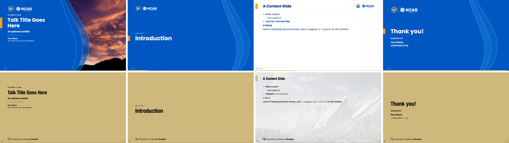
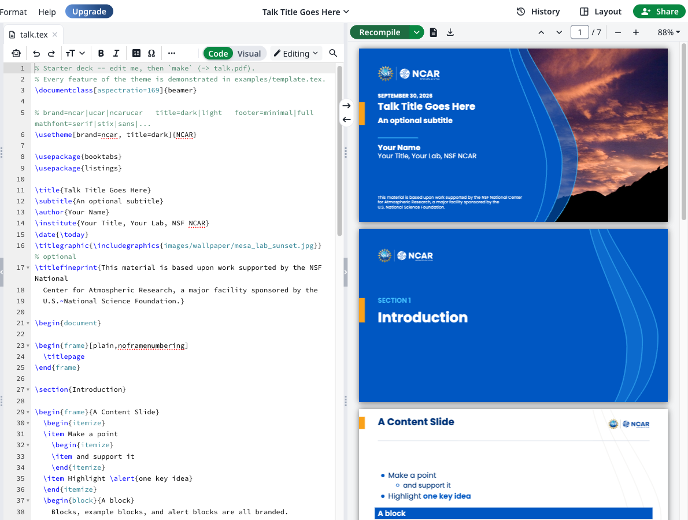
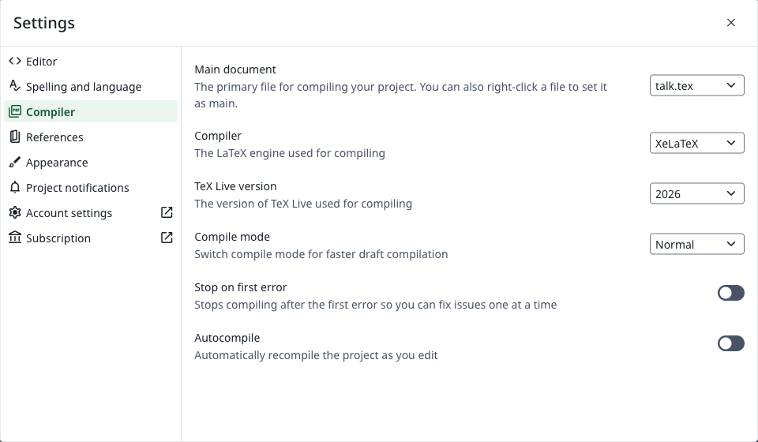
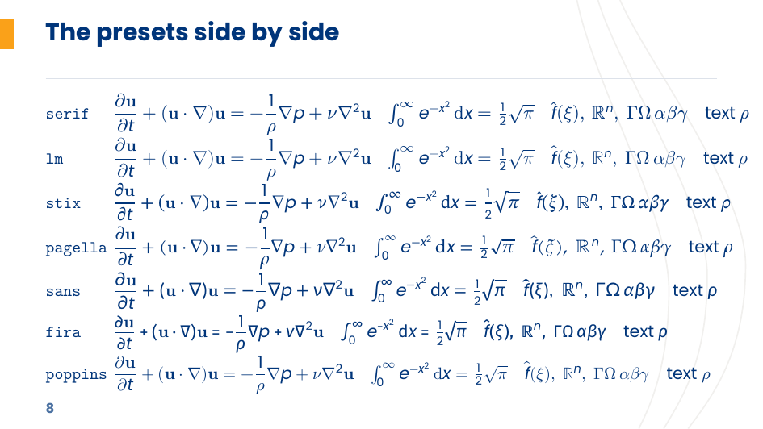

# Engine: a beamer and revealjs theme with brand liveries

One layout engine, many brand **liveries**. Write your slides in **LaTeX beamer**
or **Quarto Markdown**: a PDF, and from the same Markdown an **HTML** (revealjs)
deck to present in a browser. A livery is a directory of brand data (colors,
fonts, logos, geometry, art); the engine draws every slide from it.

The NCAR family's liveries ship here as the reference liveries: **NSF NCAR** (`ncar`),
**UCAR** (`ucar`), **UCP** (`ucp`) and **NSF NCAR-UCAR** (`ncarucar`). The
[`quarto-livery-decks`](https://github.com/benkirk/quarto-livery-decks) framework, built
on this engine (it adds PowerPoint output), carries the other families, each livery
with its own Overleaf link: the **University of Colorado** (`cu`, and its Center for
National Security Initiatives, `nsi`) and **NASA** (`nasa`, `nasa-dark`).

The starter deck under the `ncar` and `cu` liveries, as a PDF:


and as an HTML deck from the same Markdown:



## Quick Start

### 1. Get your own copy

Click **Use this template → Create a new repository** at the top of this
page. Or, from the command line:

```bash
gh repo create my-talk --template benkirk/beamer-livery-theme --private --clone
cd my-talk
```

### 2. Install the prerequisites

| you want | you need |
|---|---|
| LaTeX slides | TeX Live (or MacTeX / MiKTeX) with **XeLaTeX** and **latexmk**; or nothing, on [Overleaf](#overleaf) |
| Quarto HTML slides | [Quarto](https://quarto.org/docs/get-started/) ≥ 1.6 only: no TeX |
| Quarto PDF slides | the LaTeX row, plus [Quarto](https://quarto.org/docs/get-started/) ≥ 1.6. Quarto's TinyTeX (`quarto install tinytex`) also works and installs missing LaTeX packages on the fly. With a minimal TeX Live, callouts need `fontawesome5` (`texlive-fonts-extra` on Debian/Ubuntu). |

No font installation is needed: every livery bundles its fonts (Poppins for the NCAR
family). On NCAR systems, `module load texlive` provides TeX.

### 3. Write and build

| | edit | build | output |
|---|---|---|---|
| **LaTeX** | `talk.tex` | `make` | `talk.pdf` |
| **Quarto** | `talk-quarto.qmd` | `make quarto` | `talk-quarto.pdf` |
| **Quarto, HTML** | `talk-quarto.qmd` | `make html` | `talk-quarto.html` (+ `talk-quarto_files/`) |

Both starter decks contain a title slide, a section divider, a content slide,
a photo slide, code, and a closing slide. Replace the placeholder text, drop
your photos into `images/`, and rebuild. The livery is one line:
`\usetheme[brand=ucar]{Engine}` in LaTeX, `themeoptions: [brand=ucar]` in
Quarto, for a bundled one; `livery=<directory>` or `livery: <directory>` for
any other (see [Liveries](#liveries)).

Stuck? `examples/` shows every feature: [`template.tex`](examples/template.tex),
[`quarto-demo.qmd`](examples/quarto-demo.qmd), and
[`paper.tex`](examples/paper.tex) for non-slide documents. Build them with
`make examples`.

### Overleaf

No TeX to install: open the LaTeX starter deck as a new Overleaf project, with
the compiler already set to XeLaTeX:

[**Open in Overleaf**](https://www.overleaf.com/docs?snip_uri=https://github.com/benkirk/beamer-livery-theme/releases/latest/download/engine-beamer-overleaf.zip&engine=xelatex)

Or by hand: download `engine-beamer-overleaf.zip` from the
[latest release](https://github.com/benkirk/beamer-livery-theme/releases/latest),
**New Project → Upload Project**, then **Settings → Compiler → XeLaTeX**
(under pdfLaTeX the deck builds too, but in Helvetica with Computer Modern
math: the theme's pdfLaTeX fallback) and **Recompile**.





The project is `talk.tex` on the `ncar` livery, one photo, the theme's `.sty`
files in `_extensions/engine/`, the livery's fonts and logos in `liveries/ncar/`,
and a `latexmkrc` at the root that points TeX at both (Overleaf reads it; it is
the only way to set `TEXINPUTS` there). The fonts come bundled, so it compiles
within the free plan's time limit. Quarto decks stay local: Overleaf has no
Quarto.

**Other liveries** have their own links: the University of Colorado and NASA zips are on
[quarto-livery-decks' releases](https://github.com/benkirk/quarto-livery-decks#latex-and-overleaf).
The same tool packs any livery directory:

```bash
python3 _extensions/engine/overleaf_zip.py path/to/livery -o livery-overleaf.zip   # [--photo cover.jpg]
```

## Already have a project?

**A Quarto project:** add the extension to it, then use `format: engine-beamer`
(PDF) or `format: engine-revealjs` (HTML), or list both:

```bash
quarto add benkirk/beamer-livery-theme
```

**An existing LaTeX deck:** point TeX at the theme directory and switch the
theme:

```bash
export TEXINPUTS=/path/to/beamer-livery-theme/_extensions/engine//:
export TTFONTS=/path/to/beamer-livery-theme/_extensions/engine//:   # the bundled fonts
latexmk -xelatex my-talk.tex
```

```latex
\usetheme[livery=/path/to/livery]{Engine}   % any livery: a directory holding build/livery.sty
\usetheme[brand=ucar]{Engine}               % a bundled one: ncar, ucar, ucp, ncarucar
\usetheme{Engine}                           % ncar
```

**An existing Overleaf project:** upload the `_extensions/engine` and `liveries`
folders from a release zip and the zip's `latexmkrc` at the project root, then
`\usetheme[livery=liveries/<name>, fonts=bundled]{Engine}` and set the compiler
to XeLaTeX.

A deck written for the 2020-brand NCAR theme moves over with two changes (see the
[appendix](#appendix-from-the-2020-brand-ncar-theme)).

## Writing slides

| | LaTeX | Quarto Markdown |
|---|---|---|
| Title slide | `\titlepage` in a `[plain]` frame | automatic from `title:`, `subtitle:`, `author:`, `institute:`, `date:` |
| Photo on the title slide (else the livery's default, if it has one: the NCAR family's is the Mesa Lab) | `\titlegraphic{\includegraphics{photo.jpg}}`; `\enginenotitlegraphic` for the plain cover | `titlegraphic: photo.jpg`; `titlegraphic: none` for the plain cover |
| Fine print under the title | `\titlefineprint{...}` | `fineprint: "..."` |
| Section divider | `\section{...}` | `# Section` |
| Divider subtitle | `\sectionsubtitle{...}` before `\section` | a paragraph right after `# Section` |
| Slide | `\begin{frame}{Title}` | `## Title` |
| Blocks | `block`, `exampleblock`, `alertblock` | `### Title`, `### Title {.example}`, `### Title {.alert}` |
| Emphasis | `\alert{...}` | `[text]{.alert}` |
| Slide footnote (an aside at the foot, under a short rule) | `\enginefootnotespring` first in the frame and again after the content, then `\begin{enginefootnotes}\enginefootnote{†}{...}\end{enginefootnotes}` | a paragraph that starts with `†` or `‡`, anywhere on a content slide |
| Photo "feature" slide | `\begin{frame}[enginebg=photo.jpg]`, the body in `\begin{enginefeaturepanel}` | `## Title {.feature background="photo.jpg"}` |
| Full-slide figure (no title, logo or rule; optional caption) | `\begin{frame}[enginefull=diagram.pdf]`, `\enginefullcaption{...}` in the body | `## Title {.full}`, one figure, then an optional caption paragraph (below) |
| Closing slide | `\engineclosingframe{Thank you!}{...}` | `## Thank you! {.closing}` |
| Center or scale a short slide's body | `\begin{frame}[c]`, `\fontsize` | `## Title {.center scale="1.4"}` (below) |
| Code | `lstlisting` (styled automatically) | fenced code blocks (highlighting in the livery's colors) |
| Table | your own `tabular`, unstyled; `\engineth{...}` for a header cell and `\rowcolor{enginetableband}` for a band are there to use | a markdown table, drawn as in HTML: a small capitalized header over a heavy rule in the primary color, banded rows, a light closing rule |
| Callouts | | `::: {.callout-note}` and the other callout types |
| Extra logo or slide decoration | `\logo{...}`: bottom right, above the footer (space reserved) | `logo: file.png` |
| Theme options | `\usetheme[<options>]{Engine}` | `themeoptions: [<options>]` |
| Math font | `\usetheme[mathfont=stix]{Engine}` | `themeoptions: [mathfont=stix]` |
| Smaller (or larger) text | `\usetheme[typescale=0.85]{Engine}` | `type-body: 10` or `type-scale: 0.85` |

Everything in the Quarto column works in both `engine-beamer` and `engine-revealjs`.
The HTML format adds a few things of its own ([HTML slides](#html-slides-engine-revealjs)).

**Slide footnotes.** A paragraph that starts with `†` (or `‡`) is an aside, not
body text. Every one on a content slide (not a feature or closing slide),
including one inside a column, moves to the slide's foot in the order written.
There they stack under one short rule, in small muted type, with the marker
hanging in the accent color. In HTML the autofit keeps the body above them; in
the PDF two `filll` springs keep the body centered above and stand the
footnotes on the floor. (pptx output can't move content, so the framework's
`style_footnotes.py` mutes them in place.)

**Per-slide layout controls.** Six controls on the heading, each independent, act on
the body: everything but the title, speaker notes and footnotes.

| Control | Effect | HTML | PDF |
|---|---|---|---|
| `.hcenter` | centers the body across as a block; its text stays left-aligned | yes | prose, lists and code; a table or captioned figure already centers; with one of those or columns, nothing |
| `.vcenter` | centers the body between the title rule and the floor | yes | frame option `c` |
| `.center` | both (not Quarto's `.center`, which moves the title too) | yes | as above |
| `scale="S"` | sizes text, tables and code by S (0.8 shrinks) | yes; autofit shrinks an overshoot | a `\fontsize` group; no autofit, so check the page |
| `.fill` | grows the body until it just fits, up to 3× | yes | nothing (LaTeX can't measure it); add `scale=` for the PDF |
| `.caution` | sets the body on a soft field with a bar in the warning color at its left, for warning slides; footnotes stay below | yes | the `enginecaution` box |

```markdown
## Who's still on legacy {.center scale="1.4"}
## A short script {.hcenter .fill}
```

Images keep their own sizes. Highlighted code keeps its full-width shading in
the PDF, so `.hcenter` shows there only on plain code blocks.

**A full-slide figure.** `{.full}` gives one figure the whole slide: a
diagram too detailed for the space under a title. The body is a mermaid or
`{dot}` cell, or an image, then optionally a paragraph, which becomes one
muted caption line under it (more paragraphs stack). The title, logo, rule
and waves are not drawn; the frame number stays. The title stays in the
HTML page, hidden, so navigation and tools find the slide. The figure
is scaled to fit, keeping its shape, so a diagram near 16:9 uses the most of
it. A body that is anything else (a list, a second figure) draws as an
ordinary slide, with a warning.

```markdown
## Pipeline, end to end {.full}


From commit to production in one picture.
```

**Symbols the font lacks.** Poppins, the NCAR family's font, has no warning
sign or arrows. Under XeLaTeX or LuaLaTeX the PDF borrows ⚠ and → ← ↔ ⇒ from
TeX Live's DejaVu Sans (bold in a bold title), so `## ⚠︎ Check this first`
needs no raw LaTeX. The invisible U+FE0E written after that ⚠ keeps browsers
from drawing an emoji; the PDF prints nothing for it. Other missing characters
drop out, with a warning in the log.

## Options

### Theme options

| option | values | default | |
|---|---|---|---|
| `livery` | a directory holding `build/livery.sty` | the bundled `liveries/<brand>` | the brand: colors, fonts, logos, geometry, art ([Liveries](#liveries)); in Quarto the `livery:` metadata key, a directory relative to the project |
| `brand` | `ncar`, `ucar`, `ucp`, `ncarucar` | `ncar` | a bundled livery by name: NSF NCAR, UCAR, UCP, or NSF NCAR-UCAR |
| `title` | `dark`, `light` | `dark` | title/closing slide field: the primary color with the reversed logo, or white with the full-color logo (the brand's own light cover) |
| `fonts` | `brand`, `bundled`, `helvetica` | `brand` (`helvetica` under pdfLaTeX) | `brand` uses the livery's installed fonts when this machine has them, else its bundled files; `bundled` always the bundled files (reproducible; what Overleaf gets); `helvetica` the sanctioned substitute, and the only choice under pdfLaTeX |
| `footer` | `minimal`, `full` | `minimal` | page number only, or also the section, short title and date |
| `sectionpages` | `true`, `false` | `true` | a branded divider slide at each section |
| `logo` | `true`, `false` | `true` | logo on content slides (in the corner the livery names) |
| `waves` | `true`, `false` | `true` | the livery's faint wave lines behind content slides, when it has them |
| `typescale` | a factor | `1` | every text size times it; a Quarto deck sets it with `type-body: <pt>` (over the livery's body) or `type-scale:` |
| `mathfont` | `serif`, `lm`, `stix`, `pagella`, `sans`, `fira`, `poppins`, `keep`, or a font name | `serif` | the math font (next section) |
| `autofit` | `true`, `false` | `true` | HTML only: shrink overflowing content slides to fit |

The HTML format reads `livery`, `brand`, `title`, `waves` and `autofit` and
ignores the rest.

`make variants` builds `examples/template.tex` in UCAR, UCP, NCAR-UCAR, light-title,
4:3, pdfLaTeX and `mathfont=poppins` flavors.

### Math fonts

The brand fonts have no math (Poppins, Helvetica Neue). Left to itself, beamer
sets the letters of an equation in the text font's italic among Computer Modern
symbols, which is fine for a variable name in a sentence and falls apart on
anything with fractions or operators. So the theme sets a serif math font,
scaled a little to sit with a large x-height, and `mathfont=` picks which:



| `mathfont=` | font | |
|---|---|---|
| `serif` | New Computer Modern Math (Book) | the default; Latin Modern Math where it is not installed |
| `lm` | Latin Modern Math | lighter Computer Modern |
| `stix` | STIX Two Math | Times-like, compact |
| `pagella` | TeX Gyre Pagella Math | Palatino-like |
| `sans` | Lete Sans Math | a complete sans math font (Lato); Fira Math where it is not installed |
| `fira` | Fira Math | humanist sans; no bold or script alphabets |
| `poppins` | the text font's letters, Computer Modern symbols | beamer's own approach |
| `keep` | | leave the document's math setup alone |
| anything else | that OpenType math font, by name or file | for example `mathfont=XITSMath-Regular.otf` |

Under pdfLaTeX `serif` gives Computer Modern math and the other presets fall
back to it. The fonts come with TeX Live (`newcomputermodern`, `stix2-otf`,
`tex-gyre-math`, `lete-sans-math`, `firamath`; Debian and Ubuntu ship Pagella
Math in `fonts-texgyre-math`, not in `texlive-fonts-extra`); a preset whose
font is missing warns and keeps the document's math font.

In Quarto, `themeoptions: [mathfont=stix]` does the same, and Quarto's own
`mathfont:` key also works (the theme then leaves math alone). The HTML deck
is unaffected: MathJax sets its own serif math.

`\enginemathfont{<preset>}` selects a preset later in the preamble, and
`\enginemathversion{<version>}{<preset>}` sets one up as a math version to
compare several in one document; `examples/mathfonts.tex` is the specimen
above.

### Colors

The themes read only **roles**, which the livery sets: `BrandPrimary`,
`BrandPrimaryText`, `BrandPrimaryContrast`, `BrandSecondary`, `BrandAccent`,
`BrandHighlight` (a second small-text accent: examples, tips, strings),
`BrandText`, `BrandBackground`, `BrandMuted`, `BrandSurface`, `BrandWarning` and
`BrandDark`, plus the blends the builder derives (`BrandTableRule`, `BrandCautionFill`,
...). Use those in your own slides and they follow the livery. Code is set in
`BrandCodeText`, which is `BrandDark` unless the livery names another color: on a dark
livery the dark role is a field color, not a text color. Code highlighting follows the
same roles: `engine.theme` is the template, each livery's `build/livery.theme` the filled
copy, and a Quarto project points `highlight-style` at it.

Each livery also exports its **palette by name** (`latex.colors` in its
`livery.yml`), for slides that will only ever wear that brand:
- **ncar**: `NCARBlue`, `DarkBlue`, `Space`, `LightBlue`, `LightGray`, `BrandOrange`, `BrandYellow`
- **ucar**, **ucp**, **ncarucar**: those plus `UCARAqua`, `UCARAquaContrast`, `LightAqua`
- **cu**, **nsi** (quarto-livery-decks): `CUGold`, `CUBlack`, `CUDarkGray`, `CULightGray`, `CUAccessibleGold`, `CUSkyBlue`, ...
- **nasa**, **nasa-dark** (quarto-livery-decks): `NASABlue`, `NASARed`, `NASACarbon`, `NASAGray`, `NASASky`, ...

## HTML slides (`engine-revealjs`)

The same Markdown renders as a [revealjs](https://revealjs.com) web deck, in the
same layouts: the title slide with the livery's art or a photo, section dividers,
content slides with the livery's title and marks, feature and closing slides.

```bash
quarto render talk-quarto.qmd --to engine-revealjs    # or: make html
```

Open `talk-quarto.html` in a browser; keep `talk-quarto_files/` beside it.

| key | |
|---|---|
| `→` `←` / space | next / previous |
| `f` | full screen |
| `s` | speaker view: notes (`::: {.notes}`), next slide, timer |
| `m` | slide menu |
| `b` / `c` | whiteboard / draw on the slide |
| `o` / `esc` | overview |

HTML-only extras:
- **`## Title {.brand-dark}`**: a content slide on the livery's dark color with
  white text. PDF draws an ordinary slide.
- **Autofit**: a content slide that overflows shrinks its body text (down to
  65%) until it fits; the title keeps its size. Opt out per slide with
  `{.no-autofit}` or `{.scrollable}`, or per deck with `themeoptions: [autofit=false]`.
- **Live diagrams**: mermaid and Graphviz draw in the browser, filling the
  column (capped to the content height). Mermaid picks up the livery's font and
  colors. `examples/quarto-demo.qmd` has one of each.
- **Screenshots**: `{height="72%" fig-align="center"}`, the beamer recipe for a
  full-width 16:9 image, fits the HTML slide too. A smaller percentage gives
  a proportionally smaller image.
- **Fragments**: `::: {.incremental}` lists and `. . .` pauses step through.
  (Beamer PDF gets one page per step.)

**One file to email:** set `embed-resources: true` for a single self-contained
`.html` (fonts, logos and photos inlined). The whiteboard can't be embedded,
so turn it off at the same time:

```yaml
format:
  engine-revealjs:
    embed-resources: true
    chalkboard: false
```

**A PDF from the HTML deck:** open it with `?print-pdf` after the file name
(for example `talk-quarto.html?print-pdf`) in Chrome, and print to PDF with
background graphics on. For a PDF to hand out, the beamer format is usually
the better choice.

## Liveries

A livery is a directory the engine reads: `_brand.yml` (the colors and fonts, in
Quarto's [brand.yml](https://quarto.org/docs/authoring/brand.html) form),
`livery.yml` (everything else), `fonts/`, `logos/`, optionally `art/`, a
`template.pptx` for the framework's PowerPoint output, and `build/`, which
`livery_build.py` generates from the two yml files and which is committed:
`livery.json` (the resolved truth every tool reads), `livery.sty` (what
`\usetheme[livery=...]` inputs), `livery.css` (the HTML deck's colors, fonts and
logos) and `livery.theme` (code highlighting). The knobs in `livery.yml`:

| knob | |
|---|---|
| `roles` | which palette color plays each role: `primary`, `primary-text`, `primary-contrast`, `accent`, `highlight`, `muted`, `surface`, `warning`, `dark`, `code-text` |
| `geometry` | the margin, the title tab, the logo box (height per slide kind, its corner on content slides: `top-right`, `top-left`, `none`, and its `inset` from that edge, the margin by default), the page number's corner, the divider block, the full-figure paddings |
| `frametitle` | the content slides' title: `align` (`left` or `center`, in the room beside the mark), `tab` and `rule` (the accent tab and the hairline, both on by default). The body starts below the title band, or below a taller mark |
| `type` | text sizes in points on the PowerPoint canvas, by role (`body`, `frametitle`, `title`, `section`, `table`, `footnote`, ...) and `levels` (the five list levels); a role left out is the engine's default scaled to the canvas (below) |
| `signoff` | a second lockup at the foot of every slide but feature and full slides (light and dark images, aspect, height, bottom, corner) |
| `marks` | which mark and sign-off each field wears, by role: content slides `background`, covers and dividers `primary`, the band title `title.field` |
| `title` | the title slide's composition: `style: cover` (the default: the text beside the photo or the waves) or `style: band` (a band across a field, the text left of `split`, the photo right of it, the marks in the strip below) |
| `feature` | `style: bar` (the default: the photo under a dark bar holding the title, the body on a translucent panel) or `style: cover` (the title cover's field, waves and mark, the photo in its right part) |
| `compositions` | overrides of the slide compositions' boxes (below), e.g. `title: {column: {box: [0.06, 0.375, 0.50, 0.485]}}` |
| `art` | `waves` (the brand's curves as control points, drawn in the roles' colors), or a static picture per slide kind (`title`, `section`, `closing`, `content`), and `titlegraphic`, the default title photo for decks that set none (`ncar`: the Mesa Lab, which its family inherits) |
| `installed-fonts` | a proprietary face to prefer over the bundled stand-in when the machine has it (below) |
| `extends` | a parent livery: a *flavor* inherits everything and overrides what it names (`ucar` extends `ncar`; `nsi` extends `cu`) |
| `pptx` | the framework's template: its typeface, font blobs, color scheme and `size` (the canvas in inches, `[13.333, 7.5]` by default; the NSF NCAR template is `[10, 5.625]`) |
| `latex`, `css` | named palette colors for LaTeX, and `overrides/livery-extra.{sty,css}` for anything the knobs don't cover |

**Compositions.** The title (cover, with a photo, light, both, the band), closing (and light,
band), section and feature slides are boxes in `build/livery.json`'s `compositions`: per
composition its field, art, photo, band, waves, bar, panel, mark, sign-off, text column,
fineprint and eyebrow, each `[x, y, w, h]` in fractions of the slide (y down) with its role,
derived from the knobs above. beamer, the HTML theme and the template builder each draw them
with one drawer, so the formats agree; `tools/test_compositions.py` checks the numbers and the
framework's `make measure` the drawn slides.

**Type.** Text sizes are points on the livery's PowerPoint canvas (`type:` and `pptx.size`),
and every format sets them as the same share of the slide height, so a slide's text fits and
overflows alike in each, and a pptx slide pasted into a hand-made deck carries whole or half
points. A deck steps every size from the livery's with `typescale=` in LaTeX, or `type-body:`
/ `type-scale:` in Quarto ([Theme options](#theme-options)).

**Fonts.** The faces are `_brand.yml`'s `typography`: the base family, a headings family of
its own if the brand has one, and a code face (`typography.monospace`, with files of its own)
that replaces beamer's Latin Modern Mono and the HTML deck's system monospace; it is set at
its natural size, since a monospace face advancing 0.6 em matches HTML's line width already.
A livery whose brand font cannot be bundled (a commercial face) bundles a free stand-in and
may name the real one:

```yaml
installed-fonts:
  base: Helvetica Neue                  # a family: its four faces by the usual names
  headings:                             # or faces by full and PostScript name
    family: Helvetica Neue
    faces: {bold: [Helvetica Neue Condensed Bold, HelveticaNeue-CondensedBold]}
```

The HTML deck's `@font-face` rules list those faces as `local()` sources ahead
of the bundled file, so a viewer who has the font sees it and anyone else the
stand-in. The PDF uses them under `fonts=brand` when the machine that builds it
has them, and embeds them for every reader; `fonts=bundled` ignores them, which
keeps a build reproducible. The engine never copies the font: whether you may
embed an installed font in a PDF you distribute is a question for its licence.

**Dark liveries.** A livery whose `background` role is darker than its `foreground` is dark
(`livery.json` `mode: dark`; the framework's `nasa-dark`): content slides are light on dark.
Beamer mixes its tints toward the background rather than white, code takes the
`code-text` role, the HTML deck tints its callout titles from the roles and turns inline
Graphviz to the dark, and `livery_check.py` checks the code and blend colors' contrast too.

The tools, all in `_extensions/engine/`:

- `livery_build.py <dir>...` writes `build/`; `--check` fails if it is stale (CI runs it).
- `livery_check.py <dir>...` checks a livery: `build/` fresh, every file the data
  names present, the template pandoc-compliant and rebuilt byte-identically
  from the data, contrast warnings.
- `livery_template.py <dir>` builds the livery's `template.pptx` from its data.
- `overleaf_zip.py <dir> -o <zip>` packs the livery with the theme as a pure-LaTeX
  project ([Overleaf](#overleaf)).

**Making one.** The contract is section 4 of
[`docs/design/engine-and-liveries.md`](https://github.com/benkirk/quarto-livery-decks/blob/main/docs/design/engine-and-liveries.md)
(the framework's copy is the living one), and the framework README's
["Adding a livery"](https://github.com/benkirk/quarto-livery-decks#adding-a-livery)
walks through it from a reference PowerPoint: inspect, write the data, build,
check, look. Each livery's decisions live in its `reference/notes.md`.

**Brand rules (NCAR family).** The `ncar` livery (and `ucar`, `ucp`, `ncarucar`) follows the
2026 NSF NCAR / UCAR Brand Guide: the palette, Poppins, the official lockups
(the NCAR logo always with the NSF logo, full-color on light and reversed on
dark, never on busy photos, so feature slides have no logo), accents in small
amounts, and the wave super-graphic, its three lines traced from the brand's
cover art (`tools/fit-waves.py`). The logos are the official RGB lockups from
the UCAR brand portal (<https://ucar.canto.com/v/branding>); NSF NCAR, UCAR
and UCP staff may use them on presentations without further permission, for
any other use contact designhelp@ucar.edu.

## What's in the repository

```
talk.tex, talk-quarto.qmd   your starter decks (talk.tex lives in the extension, linked here,
                            so overleaf_zip.py finds it from a vendored copy too)
latexmkrc                   points latexmk at the theme (Overleaf reads it)
images/                     photos (examples use images/wallpaper/)
_extensions/engine/         the theme: Quarto extension *and* LaTeX sources
  beamerthemeEngine.sty       options; loads the color/font/inner/outer themes
  engine_livery.sty           loads the livery; fonts, math font, listings style (also for non-beamer docs)
  engine-beamer.lua           Quarto: loads the theme; Markdown sugar
  engine-revealjs.{scss,js,lua}, title-slide.html
                              the HTML (revealjs) format
  engine.theme                highlight theme template ($role colors; filled per livery)
  liveries/<name>/            a reference livery (above)
  livery_build.py             writes build/ from _brand.yml and livery.yml (--check in CI)
  livery_template.py          builds a livery's template.pptx from build/livery.json
  livery_check.py             checks a livery: build/ fresh, its files, the template (CI)
  overleaf_zip.py             packs a livery with the theme as an Overleaf/pure-LaTeX project
  livery.py, pptx_waves.py    the json reader and the wave shapes, shared with the framework
tools/fit-waves.py          fits the wave curves to a brand's cover art (the art.waves block)
tools/test_compositions.py  the compositions' boxes against their expected numbers (CI)
tools/test_type.py          the type rules, and that every template size is a role's (CI)
tools/parity.sh             snapshots every deck before and after a change
docs/                       the README's images
examples/                   feature showcase (LaTeX, Quarto, article), math font specimen
  diagrams/                   one Graphviz and one mermaid source, shared by both
                              showcases; `make diagrams` rebuilds the PDFs that
                              template.tex includes (needs Graphviz and npx)
```

**Releasing:** set `version` in `_extensions/engine/_extension.yml` (and
`VERSION` in `engine-revealjs.lua`), merge, then tag it: `git tag v<version> && git
push origin v<version>`. The `release` workflow runs `make overleaf`
(`overleaf_zip.py` on the `ncar` livery) and publishes a GitHub Release with the
zip, which is what the Overleaf link above opens; it refuses a tag that does
not match the extension version. Quarto users can pin a release:
`quarto add benkirk/beamer-livery-theme@v<version>`.

## License

Copyright © 2026 University Corporation for Atmospheric Research.

The engine, its tools and the starter files are licensed under
[CC BY-SA 4.0](https://creativecommons.org/licenses/by-sa/4.0/) (Creative
Commons Attribution-ShareAlike 4.0 International); the full text is in
[`LICENSE`](LICENSE). You may share and adapt them with attribution, provided
you distribute your changes under the same license. They are freely available
to anyone who wants to build a livery of their own.

Slides you *create* with the engine are your own content. The license covers
the engine, not what you put in your deck.

**Each livery's marks and pictures belong to their owner** and are not covered
by that license:

- **The NSF, NCAR, UCAR and UCP logos** (`_extensions/engine/liveries/*/logos/`)
  are trademarks used under the
  [UCAR brand guidelines](https://ucar.canto.com/v/branding).
- **The University of Colorado and NASA liveries' marks and photographs** (in
  quarto-livery-decks) belong to the University of Colorado and to NASA; the NASA
  insignia's use is restricted by the
  [NASA brand guidelines](https://www.nasa.gov/nasa-brand-center/brand-guidelines/).
- **The Poppins font** (`_extensions/engine/liveries/ncar/fonts/`) is
  licensed under the SIL Open Font License; see `OFL.txt` in that directory.
- **The photographs in `images/wallpaper/`** come from the NCAR beamer template as
  example imagery. Replace them with your own.

## Appendix: from the 2020-brand NCAR theme

The 2020-brand theme (`\usetheme{ncar}`, CoolGray with the `#1A658F` blue and Cormorant) is
kept at tag [`v1.0-brand2020`](https://github.com/benkirk/NCAR_beamer_template/tree/v1.0-brand2020)
and on branch `brand-2020` of `NCAR_beamer_template`. A deck written for it moves over with
two changes:

1. `\usetheme{ncar}` becomes `\usetheme{Engine}`.
2. `TEXINPUTS` and `TTFONTS` point at this repo's `_extensions/engine/` (see
   [Already have a project?](#already-have-a-project)).

How its pieces map:

| 2020-brand theme | Engine |
|---|---|
| `NCARtitleframe[img]` | the title slide; its body (usually `\vspace` plus `\maketitle`) is ignored |
| `NCARprettyframe[img]` | a photo feature frame, or a brand-field frame without an image |
| its color names (`NCARBlue`, `CoolGray11`, `DeepBlue`, ...) | compile, mapped onto the nearest 2026 colors; `HilightGreen` is an NCAR Blue text highlight, legible on white |
| `\logo{...}` | decorates the bottom of a slide |
| `listings` | loaded automatically; your own `\lstset` applies |
| `\titlebackground`, `\nobackground`, `\defaultbackground` | accepted, and do nothing |
| no divider slides | a divider slide at each `\section` (`sectionpages=false` turns them off) |
| the section name in the footer | `footer=full` |
| Helvetica text | Poppins, which is wider: a slide packed to the limit may need trimming or `[shrink]` |
| math in the text font | a serif math font (`mathfont=poppins` for the text font's letters) |
| plain content slides | the brand's faint wave lines (`waves=false` removes them) |

## Origins

This engine generalizes
[`benkirk/NCAR_beamer_template`](https://github.com/benkirk/NCAR_beamer_template), which
remains the single-brand NCAR theme, to any brand through liveries; the two share their
code, and fixes to the NCAR theme are carried over here. The Quarto deck framework built on
it is [`benkirk/quarto-livery-decks`](https://github.com/benkirk/quarto-livery-decks).
