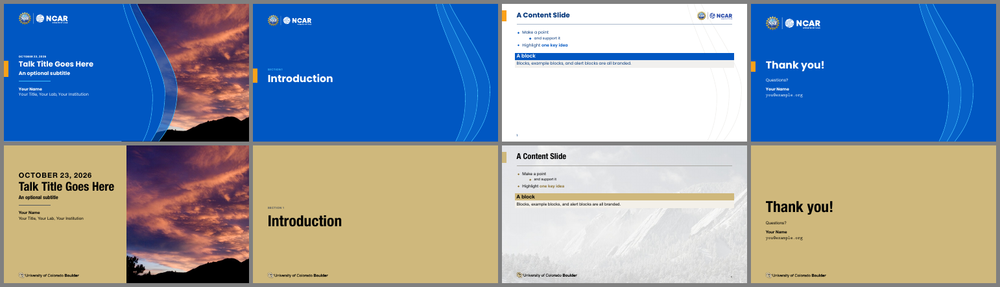
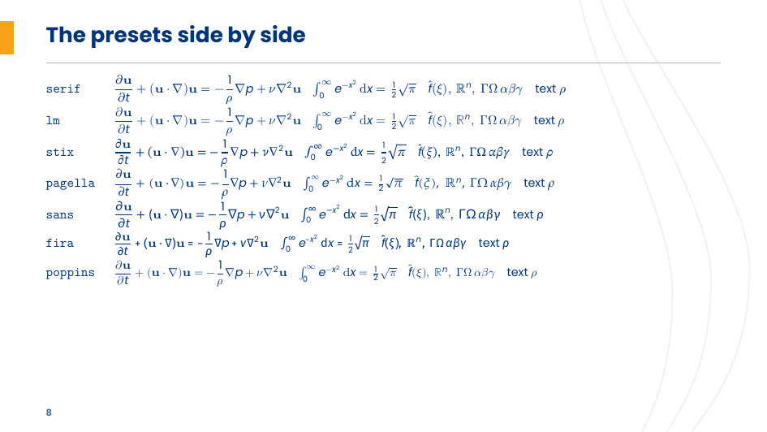

# LaTeX and Overleaf

Every livery is also a pure-LaTeX beamer theme, with no Quarto in the loop:
`\usetheme[livery=<dir>]{Engine}`, a bundled one being `livery=liveries/<name>`. The starter deck under the `ncar` and `cu` liveries:



## Overleaf

Each release of this repo carries one project zip per livery: the theme's `.sty`, the
livery's fonts, logos and art, a `latexmkrc`, and a starter `talk.tex` on
`\usetheme[livery=liveries/<name>, fonts=bundled]{Engine}`. One click opens it
as a new Overleaf project:

| livery | | |
|---|---|---|
| `ncar` | [**Open in Overleaf**](https://www.overleaf.com/docs?snip_uri=https://github.com/benkirk/quarto-livery-decks/releases/latest/download/ncar-overleaf.zip&engine=xelatex) | [ncar-overleaf.zip](https://github.com/benkirk/quarto-livery-decks/releases/latest/download/ncar-overleaf.zip) |
| `ucar` | [**Open in Overleaf**](https://www.overleaf.com/docs?snip_uri=https://github.com/benkirk/quarto-livery-decks/releases/latest/download/ucar-overleaf.zip&engine=xelatex) | [ucar-overleaf.zip](https://github.com/benkirk/quarto-livery-decks/releases/latest/download/ucar-overleaf.zip) |
| `ucp` | [**Open in Overleaf**](https://www.overleaf.com/docs?snip_uri=https://github.com/benkirk/quarto-livery-decks/releases/latest/download/ucp-overleaf.zip&engine=xelatex) | [ucp-overleaf.zip](https://github.com/benkirk/quarto-livery-decks/releases/latest/download/ucp-overleaf.zip) |
| `ncarucar` | [**Open in Overleaf**](https://www.overleaf.com/docs?snip_uri=https://github.com/benkirk/quarto-livery-decks/releases/latest/download/ncarucar-overleaf.zip&engine=xelatex) | [ncarucar-overleaf.zip](https://github.com/benkirk/quarto-livery-decks/releases/latest/download/ncarucar-overleaf.zip) |
| `cu` | [**Open in Overleaf**](https://www.overleaf.com/docs?snip_uri=https://github.com/benkirk/quarto-livery-decks/releases/latest/download/cu-overleaf.zip&engine=xelatex) | [cu-overleaf.zip](https://github.com/benkirk/quarto-livery-decks/releases/latest/download/cu-overleaf.zip) |
| `nsi` | [**Open in Overleaf**](https://www.overleaf.com/docs?snip_uri=https://github.com/benkirk/quarto-livery-decks/releases/latest/download/nsi-overleaf.zip&engine=xelatex) | [nsi-overleaf.zip](https://github.com/benkirk/quarto-livery-decks/releases/latest/download/nsi-overleaf.zip) |
| `nasa` | [**Open in Overleaf**](https://www.overleaf.com/docs?snip_uri=https://github.com/benkirk/quarto-livery-decks/releases/latest/download/nasa-overleaf.zip&engine=xelatex) | [nasa-overleaf.zip](https://github.com/benkirk/quarto-livery-decks/releases/latest/download/nasa-overleaf.zip) |
| `nasa-dark` | [**Open in Overleaf**](https://www.overleaf.com/docs?snip_uri=https://github.com/benkirk/quarto-livery-decks/releases/latest/download/nasa-dark-overleaf.zip&engine=xelatex) | [nasa-dark-overleaf.zip](https://github.com/benkirk/quarto-livery-decks/releases/latest/download/nasa-dark-overleaf.zip) |

By hand: download a zip, then **New Project → Upload Project**, **Menu → Compiler →
XeLaTeX** and **Recompile**. Under pdfLaTeX the deck builds too, but in Helvetica with
Computer Modern math, the theme's pdfLaTeX fallback.


The same zip, unzipped, is the local path: `latexmk -xelatex talk.tex` builds it
with nothing but XeLaTeX. To pack one yourself: `make overleaf LIVERY=cu` in any
deck directory writes `cu-overleaf.zip`, with `livery zip`; a repo
that uses this framework packs its own livery with `make overleaf LIVERY_DIR=<dir>`.
The starter always uses the bundled fonts: a livery that prefers an installed face
(`installed-fonts`) would probe the system by name, which is too slow for a free
Overleaf compile. An existing Overleaf project takes the `_extensions/engine` and
`liveries` folders of a zip and its `latexmkrc` at the project root, then
`\usetheme[livery=liveries/<name>, fonts=bundled]{Engine}`.

Pushing a `v*` tag runs `release.yml`, which attaches the zips to that release (see
[`liveries/README.md`](../liveries/README.md), "Release"); CI (`ci.yaml`, the livery matrix) compiles each livery's zip
in a clean directory on every push.

## The starter and the examples

This directory holds the engine's own LaTeX decks; build them here:

| | `make` target | output |
|---|---|---|
| the starter deck, `talk.tex` (a link to the extension's copy, which the Overleaf zips carry) | `make` | `talk.pdf` |
| every feature: `examples/template.tex`; `paper.tex`, a document that is not slides; `mathfonts.tex`, the math-font specimen; `quarto-demo.qmd` | `make examples` | `examples/*.pdf` |
| `template.tex` under UCAR, UCP, NCAR-UCAR, the light title, 4:3, pdfLaTeX and `mathfont=poppins` | `make variants` | `examples/template-*.pdf` |
| the Quarto demo as an HTML deck | `make html` | `examples/quarto-demo.html` |

`make latex` at the top of the repo builds the first three. They need TeX Live (or MacTeX,
MiKTeX) with XeLaTeX and latexmk, and no fonts: the Makefile points `TEXINPUTS` and
`TTFONTS` at `_extensions/engine/`, `liveries/` and the repo root, where the theme and the
liveries' bundled fonts are, as an Overleaf zip's `latexmkrc` does. With a
minimal TeX Live, the demo's callouts need `fontawesome5` (`texlive-fonts-extra` on Debian
and Ubuntu). The demo names no `livery:`, so it shows the default: Quarto finds
`liveries/ncar` beside `_extensions/`, a link in `examples/`.

## An existing LaTeX deck

Point TeX at the theme and the liveries, then switch the theme:

```bash
QLD=/path/to/quarto-livery-decks
export TEXINPUTS=$QLD/_extensions/engine//:$QLD/liveries//:$QLD/:
export TTFONTS=$QLD/:$QLD/liveries//:   # the bundled fonts
latexmk -xelatex my-talk.tex
```

```latex
\usetheme[livery=/path/to/livery]{Engine}   % any livery: a directory holding build/livery.sty
\usetheme[livery=liveries/ucar]{Engine}     % a bundled one, found through TEXINPUTS
\usetheme{Engine}                           % liveries/ncar
```

## Writing slides in LaTeX

A Quarto deck writes the same things in Markdown ([docs/formats.md "PDF (beamer)"](../docs/formats.md#pdf-beamer); the sample deck has every one).

| | LaTeX |
|---|---|
| Title slide | `\titlepage` in a `[plain]` frame |
| Photo on the title slide (else the livery's default, if it has one: the NCAR family's is the Mesa Lab) | `\titlegraphic{\includegraphics{photo.jpg}}`; `\enginenotitlegraphic` for the plain cover |
| Fine print under the title | `\titlefineprint{...}` |
| Section divider | `\section{...}` |
| Divider subtitle | `\sectionsubtitle{...}` before `\section` |
| Slide | `\begin{frame}{Title}` |
| Blocks | `block`, `exampleblock`, `alertblock` |
| Emphasis | `\alert{...}` |
| Slide footnote (an aside at the foot, under a short rule) | `\enginefootnotespring` first in the frame and again after the content, then `\begin{enginefootnotes}\enginefootnote{†}{...}\end{enginefootnotes}` |
| Photo "feature" slide | `\begin{frame}[enginebg=photo.jpg]`, the body in `\begin{enginefeaturepanel}` |
| Full-slide figure (no title, logo or rule; optional caption) | `\begin{frame}[enginefull=diagram.pdf]`, `\enginefullcaption{...}` in the body |
| Closing slide | `\engineclosingframe{Thank you!}{...}` |
| Center or scale a short slide's body | `\begin{frame}[c]`, `\fontsize` |
| Code | `lstlisting` (styled automatically) |
| Table | your own `tabular`, unstyled; `\engineth{...}` for a header cell and `\rowcolor{enginetableband}` for a band are there to use |
| Extra logo or slide decoration | `\logo{...}`: bottom right, above the footer (space reserved) |
| Theme options | `\usetheme[<options>]{Engine}` |
| Math font | `\usetheme[mathfont=stix]{Engine}` |
| Smaller (or larger) text | `\usetheme[typescale=0.85]{Engine}` |

## Theme options

| option | values | default | |
|---|---|---|---|
| `livery` | a directory holding `build/livery.sty`; a bundled one is `liveries/<name>`, found through `TEXINPUTS` | `liveries/ncar` | the brand: colors, fonts, logos, geometry, art; in Quarto the `livery:` metadata key, a directory relative to the project (this framework sets `livery: _livery`; without one, `liveries/ncar` beside `_extensions/`) |
| `title` | `dark`, `light` | `dark` | title/closing slide field: the primary color with the reversed logo, or white with the full-color logo (the brand's own light cover) |
| `fonts` | `brand`, `bundled`, `helvetica` | `brand` (`helvetica` under pdfLaTeX) | `brand` uses the livery's installed fonts when this machine has them, else its bundled files; `bundled` always the bundled files (reproducible; what Overleaf gets); `helvetica` the sanctioned substitute, and the only choice under pdfLaTeX |
| `footer` | `minimal`, `full` | `minimal` | page number only, or also the section, short title and date |
| `sectionpages` | `true`, `false` | `true` | a branded divider slide at each section |
| `logo` | `true`, `false` | `true` | logo on content slides (in the corner the livery names) |
| `waves` | `true`, `false` | `true` | the livery's faint wave lines behind content slides, when it has them |
| `typescale` | a factor | `1` | every text size times it; a Quarto deck sets it with `type-body: <pt>` (over the livery's body) or `type-scale:` |
| `mathfont` | `serif`, `lm`, `stix`, `pagella`, `sans`, `fira`, `poppins`, `keep`, or a font name | `serif` | the math font (next section) |
| `autofit` | `true`, `false` | `true` | HTML only: shrink overflowing content slides to fit |

A Quarto deck here sets them with `themeoptions:` ([docs/formats.md "PDF (beamer)"](../docs/formats.md#pdf-beamer)); its livery comes from
`LIVERY=`. The HTML format reads `title`, `waves` and `autofit` (and the `livery:` key) and
ignores the rest.

## Math fonts

The brand fonts have no math (Poppins, Helvetica Neue). Left to itself, beamer
sets the letters of an equation in the text font's italic among Computer Modern
symbols, which is fine for a variable name in a sentence and falls apart on
anything with fractions or operators. So the theme sets a serif math font,
scaled a little to sit with a large x-height, and `mathfont=` picks which:



| `mathfont=` | font | |
|---|---|---|
| `serif` | New Computer Modern Math (Book) | the default; Latin Modern Math where it is not installed |
| `lm` | Latin Modern Math | lighter Computer Modern |
| `stix` | STIX Two Math | Times-like, compact |
| `pagella` | TeX Gyre Pagella Math | Palatino-like |
| `sans` | Lete Sans Math | a complete sans math font (Lato); Fira Math where it is not installed |
| `fira` | Fira Math | humanist sans; no bold or script alphabets |
| `poppins` | the text font's letters, Computer Modern symbols | beamer's own approach |
| `keep` | | leave the document's math setup alone |
| anything else | that OpenType math font, by name or file | for example `mathfont=XITSMath-Regular.otf` |

Under pdfLaTeX `serif` gives Computer Modern math and the other presets fall
back to it. The fonts come with TeX Live (`newcomputermodern`, `stix2-otf`,
`tex-gyre-math`, `lete-sans-math`, `firamath`; Debian and Ubuntu ship Pagella
Math in `fonts-texgyre-math`, not in `texlive-fonts-extra`); a preset whose
font is missing warns and keeps the document's math font.

In Quarto, `themeoptions: [mathfont=stix]` does the same, and Quarto's own
`mathfont:` key also works (the theme then leaves math alone). The HTML deck
is unaffected: MathJax sets its own serif math.

`\enginemathfont{<preset>}` selects a preset later in the preamble, and
`\enginemathversion{<version>}{<preset>}` sets one up as a math version to
compare several in one document; `examples/mathfonts.tex` is
the specimen above.

## Colors

The themes read only **roles**, which the livery sets: `BrandPrimary`,
`BrandPrimaryText`, `BrandPrimaryContrast`, `BrandSecondary`, `BrandAccent`,
`BrandHighlight` (a second small-text accent: examples, tips, strings),
`BrandText`, `BrandBackground`, `BrandMuted`, `BrandSurface`, `BrandWarning` and
`BrandDark`, plus the blends the builder derives (`BrandTableRule`, `BrandCautionFill`,
...). Use those in your own slides and they follow the livery. The chart colors are
`EngineData1`, `EngineData2`, ..., `EngineDataMuted` and `EngineStatusGood`/`Warning`/`Serious`/
`Critical`; a document that loads pgfplots plots in them by default (the `livery` cycle list). Code is set in
`BrandCodeText`, which is `BrandDark` unless the livery names another color: on a dark
livery the dark role is a field color, not a text color. Code highlighting follows the
same roles: `engine.theme` is the template, each livery's `build/livery.theme` the filled
copy, and a Quarto project points `highlight-style` at it.

Each livery also exports its **palette by name** (`latex.colors` in its
`livery.yml`), for slides that will only ever wear that brand:
- **ncar**: `NCARBlue`, `DarkBlue`, `Space`, `LightBlue`, `LightGray`, `BrandOrange`, `BrandYellow`
- **ucar**, **ucp**, **ncarucar**: those plus `UCARAqua`, `UCARAquaContrast`, `LightAqua`
- **cu**, **nsi**: `CUGold`, `CUBlack`, `CUDarkGray`, `CULightGray`, `CUAccessibleGold`, `CUSkyBlue`, ...
- **nasa**, **nasa-dark**: `NASABlue`, `NASARed`, `NASACarbon`, `NASAGray`, `NASASky`, ...
