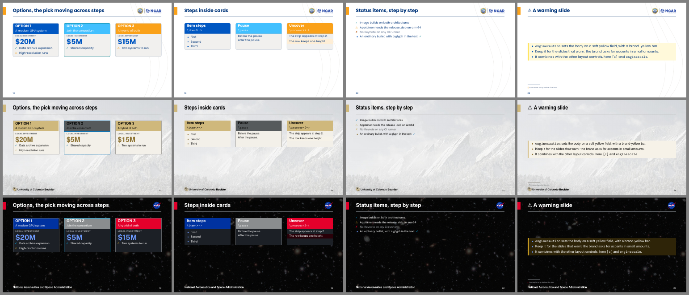

# Writing slides in LaTeX

The theme is beamer with a livery; everything beamer does works. What this page adds is the
layer the engine draws the framework's slide patterns with, written as a hand author writes it:
columns at shares, a lead box, cards, strips, status lists, quotes, the agenda, steps and
timelines, image galleries, a caution box, notes, slide footnotes and citations, a scale group,
the marking strips. `examples/sample.tex` is the cookbook, the twin of the Quarto cookbook
`decks/sample/sample.qmd` slide for slide (`make examples` here); `make variants` builds it under
`cu`, under the dark livery `nasa-dark` and at 4:3. Four of its pattern slides under three
liveries:



## The patterns

A Quarto deck writes the same things in Markdown ([docs/formats.md "PDF (beamer)"](../docs/formats.md#pdf-beamer);
[docs/authoring.md](../docs/authoring.md) has every one).

| | LaTeX |
|---|---|
| Title slide | `\titlepage` in a `[plain]` frame |
| Photo on the title slide (else the livery's default, if it has one: the NCAR family's is the Mesa Lab) | `\titlegraphic{\includegraphics{photo.jpg}}`; `\enginenotitlegraphic` for the plain cover |
| Fine print on the cover | `\titlefineprint{...}`; the livery's default (if any) without it, `\titlefineprint{}` for none |
| Section divider | `\section{...}` |
| Divider subtitle | `\sectionsubtitle{...}` before `\section` |
| Agenda: the numbered sections, a row each, each `\sectionsubtitle` under its title; in a section, that one current | `\begin{frame}{Agenda}\engineagenda\end{frame}` (from the table of contents: `latexmk` runs LaTeX twice); a plain `\tableofcontents` draws the same rows, none current |
| "SECTION 3 OF 5" over a divider, under a livery with `section.progress` | `\enginesectiontotal{5}` in the preamble: the numbered sections' count (a livery without it ignores the line) |
| Divider outside the count (an appendix, the backup slides) | `\enginesectionunnumbered{Backup}{A subtitle}` between frames, `{}` for no subtitle: no eyebrow, and no `\section`, so no counter step, table-of-contents line or PDF bookmark (`\section*` still steps beamer's counter) |
| Slide | `\begin{frame}{Title}` |
| Blocks | `block`, `exampleblock`, `alertblock` |
| Emphasis | `\alert{...}` |
| Columns at shares, the livery's gap between them (and its rule, when it draws one) | `\begin{enginecolumns}{2,1}`, each column opened by `\enginecolumn`; `{3}` is three equal columns, `{55,45}` weights, `{0.6,0.3}` shares of the row (the rest stays empty) |
| A plain beamer `columns` block at the same widths | `\begin{column}{\enginecolshare{0.6667}{2}\linewidth}` (a share, the column count), `\enginecolrule` before each column but the first |
| Wide body (the slide less `geometry.wide-margin` a side): room for four columns or a wide table | `\begin{enginewide} ... \end{enginewide}` round the body |
| Lead box over a row of cards, or alone | `\begin{enginelead} ... \end{enginelead}`; each line its own paragraph (`\par`) |
| Cards, side by side at one height | `\begin{enginecards}{3}` holding `\begin{enginecard}[<keys>]{Title}{Sub}` (next section) |
| A strip, in a card or on its own | `\begin{enginestrip}[role=accent] ... \end{enginestrip}` |
| A quote: its lines in the quote size beside a bar, the attribution under them | `\begin{enginequote}[role=accent]{Richard Hamming, 1962} ... \end{enginequote}`; `{}` for no attribution, no `role=` for the livery's bar color (`boxes.quote`); in a card or a column too |
| Steps of a process on a rail, a numbered badge each | `\begin{enginesteps}[role=secondary]{3}` holding `\begin{enginestep}{Title} ... \end{enginestep}` (["Steps and timelines"](#steps-and-timelines)) |
| A timeline: milestones on a rail, the date above each dot | `\begin{enginetimeline}{4}` holding `\enginemilestone[done]{Q1 2025}{Label}`; without `[done]` the dot is hollow |
| An image gallery: equal cells of pictures, a caption under each | `\begin{enginegallery}[cols=3,rows=2,fit=cover,height=0.6]` holding `\engineimage[Caption]{file.png}` per picture (["Galleries"](#galleries)) |
| Status list: ✓ ⚠ ✗ as the bullets | `\begin{enginestatus}` with `\done`, `\warn`, `\fail` items (and plain `\item`); `\engineglyph{done}` is the glyph anywhere |
| Warning slide: the body on a soft field with a bar, both in the livery's warning role | `\begin{enginecaution} ... \end{enginecaution}` |
| Note under a figure or table (the caption's look: small, muted, centered) | `\enginenote{...}` |
| Scale the body (its lists, tables and code with it) | `\begin{enginescale}{1.4} ... \end{enginescale}`; beamer's `[shrink]` goes the other way, down to fit |
| Center a short slide's body | `\begin{frame}[c]`; a list as a block: `\begin{center}\begin{varwidth}{\linewidth}` (the `varwidth` package) |
| Marking strips on every slide (`marking:` in a Quarto deck) | `\enginemarking{CUI}` in the preamble sets the livery's first strip, `\enginemarking[legend]{...}` one by its name; `{}` turns a strip's default off |
| A watermark on every slide (`watermark:` in a Quarto deck) | `\enginewatermark{DRAFT}` in the preamble: the word centered and turned behind the body, in the livery's `watermark:` look (a composed frame's text color, on-dark on a dark frame); `{}` turns a livery's default off |
| Slide footnote (an aside at the foot, under a short rule) | `\enginefootnotespring` first in the frame and again after the content, then `\begin{enginefootnotes}\enginefootnote{†}{...}\end{enginefootnotes}` |
| A numbered footnote (beamer's), in the slide footnotes' look | `\footnote{...}`: muted, its mark bold in the accent, under the same short rule |
| Citations (biblatex, author-year) | `\usepackage[style=authoryear,backend=bibtex]{biblatex}` and `\addbibresource{references.bib}` in the preamble (`backend=biber` where biber is installed); `\parencite{key}`, `\textcite{key}`, `\footcite{key}` (a footnote at the frame's foot) |
| The reference list | `\begin{frame}[allowframebreaks]{References}\printbibliography[heading=none]\end{frame}`: the footnote size, a 1.5 em hanging indent; a long list runs on, (1), (2) |
| Photo "feature" slide | `\begin{frame}[enginebg=photo.jpg]`, the body in `\begin{enginefeaturepanel}` |
| Dark slide: the frame on the livery's dark role, its text on-dark, its accents secondary, the dark role's mark; a card keeps its colors (a no-op on a dark livery) | `\begin{frame}[enginedark]{Title}` |
| Full-slide figure (no title, logo or rule; optional caption) | `\begin{frame}[enginefull=diagram.pdf]`, `\enginefullcaption{...}` in the body; the bare `[enginefull]` with an `enginegallery` in the body fills the slide with the gallery |
| Closing slide | `\engineclosingframe{Thank you!}{...}` |
| Speaker notes | `\note{...}` in the frame; `\setbeameroption{show notes}` in the preamble shows them |
| Code | `lstlisting` (styled automatically; the frame `[fragile]`), `\lstinputlisting{file}` |
| Table | your own `tabular`, unstyled; `\engineth{...}` for a header cell and `\rowcolor{enginetableband}` for a band are there to use, and the cookbook's Tables slide draws the rules as the theme draws a Quarto table |
| Extra logo or slide decoration | `\logo{...}`: bottom right, above the footer (space reserved) |
| Theme options | `\usetheme[<options>]{Engine}` ([latex/README.md "Theme options"](README.md#theme-options)) |
| Math font | `\usetheme[mathfont=stix]{Engine}` |
| Smaller (or larger) text, every slide | `\usetheme[typescale=0.85]{Engine}` |

The colors are the livery's roles (`BrandPrimary`, `BrandAccent`, ...; [latex/README.md "Colors"](README.md#colors)),
and a `role=` below takes a role's name.

## Cards, strips and status lists

The cookbook's Options slide, as the Quarto one in [docs/authoring.md "Cards and lead boxes"](../docs/authoring.md#cards-and-lead-boxes):

```latex
\begin{enginelead}
  \textbf{Three ways to spend the next allocation}\par
  Each trades local capacity against a share of the consortium system.
\end{enginelead}
\begin{enginecards}{3}                       % three equal cards; {2,1,1} weights; {0.5,0.25,0.25} shares
  \begin{enginecard}[pick]{OPTION 1}{A modern GPU system}    % role by place: primary
    \textbf{Total cost \$30M}
    \enginelabel{Local investment}
    \enginebig{\$20M}
    \begin{enginestrip}[role=accent]
      → \textbf{\$10M} to the consortium
    \end{enginestrip}
    \begin{enginestatus}
      \done Data archive expansion
      \warn High-resolution runs
    \end{enginestatus}
  \end{enginecard}
  \begin{enginecard}{OPTION 2}{Join the consortium}          % secondary
    ...
  \end{enginecard}
  \begin{enginecard}[solid]{OPTION 3}{}                      % accent, all the role's; no sub-line
    ...
  \end{enginecard}
\end{enginecards}
```

- **`enginecards{<shares>}`** opens the row: a number is that many equal cards; a comma list is a
  weight per card, kept as shares of the row when they add to 1 or less, else divided by their
  sum. A card beyond the shares is an error. The row draws every card at one height, the
  tallest body and head, as HTML and pptx do; a card's body is set first into a box, so
  verbatim works inside it.
- **`enginecard[<keys>]{Title}{Sub}`**: both braces are mandatory, `{}` for no sub-line. The
  keys: `role=<name>` colors the head band, a role or blend of the livery (`primary`,
  `secondary`, `accent`, `highlight`, `table-band`, ...), else any defined color (the livery's
  exported palette, your own `\definecolor`); a name that is neither warns in the log and takes
  the default, the card's place in the row (`boxes.card.roles`: primary, secondary, accent,
  around again). `pick` draws the outline; `solid` fills the card with the role, its text in the
  primary text color; `plain` is a column beside cards, no fill, no band.
- **`pick=<overlay>`** moves the pick across steps: `pick=<1>` on the first card, `pick=<2>` on
  the second. The outline's width is reserved on every step, so nothing moves between them. The
  cookbook's "Options, the pick moving across steps" is the three-step version. A spec with a
  comma goes in braces, `pick={<1,3>}`: the keys are split at commas.
- **`\enginelabel{...}`** is the small-caps label and **`\enginebig{...}`** the big number, each
  a line of its own.
- **`enginestrip[role=]`** is a band in its role's tint (default `accent`), as wide as the card
  it sits in; on a solid card, the role itself.
- **`enginestatus`** is an itemize whose `\done`, `\warn` and `\fail` items carry ✓ ⚠ ✗ as
  their bullets in the livery's status colors, a failed item's text muted; `\item` is an ordinary
  bullet among them. Each takes an overlay spec as `\item` does: `\warn<2->`. The three names are
  defined only inside the environment.
- **Overlays inside cards** work as anywhere in beamer: `\item<+->`, `\pause`, `\uncover<2->{...}`.
  `\uncover` keeps the row one height across the steps; `\only` would make it jump. The
  cookbook's "Steps inside cards" has all three.

## Steps and timelines

The cookbook's "A process, step by step" and "A timeline", as the Quarto ones in
[docs/authoring.md "Steps and timelines"](../docs/authoring.md#steps-and-timelines):

```latex
\begin{enginesteps}[role=secondary]{3}            % three equal steps; role= as a card's
  \begin{enginestep}{Propose} A one-page case; the review board reads it in a week. \end{enginestep}
  \begin{enginestep}{Pilot} Six weeks. \par \uncover<2->{A second line, at step 2.} \end{enginestep}
  \begin{enginestep}{Scale} The allocation follows the pilot's numbers. \end{enginestep}
\end{enginesteps}

\begin{enginetimeline}{3}                          % role= too
  \enginemilestone[done]{Q1 2025}{Proposal accepted}   % [done]: a filled dot
  \enginemilestone[done]{Q3 2025}{Pilot complete}
  \enginemilestone{2026}{Full allocation}               % a hollow dot
\end{enginetimeline}
```

- **`enginesteps[role=]{<n>}`** and **`enginetimeline[role=]{<n>}`** open a row of n equal items,
  the livery's column gap between them; an item beyond n is an error, and six is the most. A
  longer process goes on over a second frame, `\begin{enginesteps}[start=7]{3}` numbering its
  badges from 7. A
  thin rail (the livery's `boxes.rail`: the `rule` blend by default) runs through the marks from
  the first to the row's right edge. `role=` colors the badges and dots as it colors a card's band
  (a role, a blend or a defined color). The default is `primary-contrast`, the primary that reads
  on the background: a mark is a small shape, and on a dark livery the primary itself does not
  show. A `role=` you pick should read on the background too.
- **`enginestep{Title}`** is a step: its badge (the number knocked out in the background color, so
  it reads wherever the badge does), its title bold under the badge, its text below. The text is set into a box first, as a
  card's body, so overlays work inside it (`\uncover` keeps the row one height across the steps).
- **`\enginemilestone[done]{Date}{Label}`** is a milestone: its date bold above its dot, its label
  under it; `[done]` fills the dot in the role, else the dot is hollow, ringed in it.
- Keep a step to two or three lines: the row is as tall as its tallest step, and beamer does not
  shrink a frame to fit.

## Galleries

The cookbook's three gallery slides, as the Quarto ones in
[docs/authoring.md "Image galleries"](../docs/authoring.md#image-galleries):

```latex
\begin{enginegallery}[cols=3,rows=2,height=0.75]   % under a line of text: give height=
  \engineimage[The Blue Marble]{images/gallery-1.jpg}
  \engineimage{images/gallery-2.jpg}               % no caption: the line is kept
  ...
\end{enginegallery}

\begin{frame}[enginefull]                          % the bare key: no picture of its own
  \enginefullcaption{The cells fill the slide; this line is the caption.}
  \begin{enginegallery}[cols=3,rows=2,fit=cover] ... \end{enginegallery}
\end{frame}
```

- **`enginegallery[<keys>]`** lays its images out in equal cells, row-major, the livery's
  `boxes.gallery.gap` apart, each picture inset by `boxes.gallery.pad`. `cols=` and `rows=` set the
  grid; without them it is as square as the count allows (five images: 3 by 2), and one given alone
  sets the other. At most twelve images, and no more than `cols` x `rows`: either is an error.
- **`fit=contain`** (the default) shows each picture whole, letterboxed in its cell; **`fit=cover`**
  scales it to fill the cell and clips the rest.
- **`\engineimage[Caption]{file}`** adds a picture; its caption is one line under it, in the caption
  size, muted. When any image has a caption, every cell keeps the caption line, so a row lines up.
- **`height=`** is the gallery's share of the body box (default `1`, the whole box, capped at the
  frame's room under its title). TeX cannot measure what stands above the gallery in the frame, so
  give `height=` when there is text above it, or it runs past the foot.
- In a bare **`[enginefull]`** frame the environment only stores its images: the frame's
  background fills the slide less the full-slide pads with them (no title, logo or rule), and
  `\enginefullcaption` is the caption line, as for a full-slide figure. A `{.wide}` body
  (`enginewide`) widens a gallery with it.

## Out of scope for LaTeX

What the Quarto decks do that a LaTeX deck does not, and the LaTeX way:

| Quarto | Why not here | In LaTeX |
|---|---|---|
| Mermaid and Graphviz cells | Quarto renders them in a headless browser or WASM at build time | `make diagrams` renders `examples/diagrams/*.mmd` and `*.dot` to PDFs once; `\includegraphics` them, or draw in TikZ with the roles' colors |
| Diagrams recolored on a dark livery | a filter over those baked pictures | draw the diagram in the roles (`BrandText`, `BrandBackground`), and it follows the livery |
| Executable code cells | Jupyter runs them at render | capture the session to a file, `\lstinputlisting` it (the cookbook's "Showing captured shell output") |
| matplotlib plots in the deck | Jupyter again | plot outside the deck with the charts bundle (`livery zip --charts`: the livery's style and `livery_mpl` helper), `\includegraphics` the PDF |
| The linked-image footer | `linked-images.lua` writes it per format | `\href{url}{\includegraphics{...}}` and the URL as a slide footnote (`\enginefootnote`) |
| Quarto callouts | Quarto's own tcolorboxes | beamer's `block`, `exampleblock`, `alertblock`, or a `tcolorbox` in the roles |
| HTML autofit and `{.fill}` | a browser measures the slide | `[shrink]` on the frame, `enginescale`, `typescale=` for the deck |
| `date: last-modified` | Quarto reads the file's time | `\date{\today}` |
| `` | a Quarto shortcode | `\lstinputlisting{file}` to show it, `\input{file}` to use it |
| Speaker notes in PowerPoint's pane | a pptx has one | `\note{...}`, shown by `\setbeameroption{show notes}` (or `show notes on second screen=right`) |
